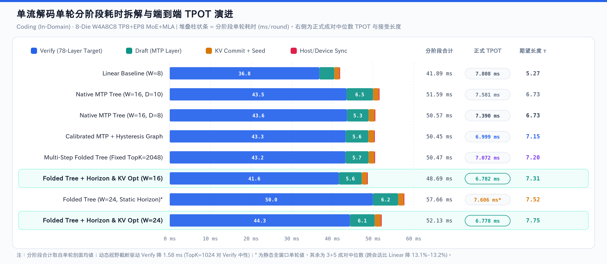
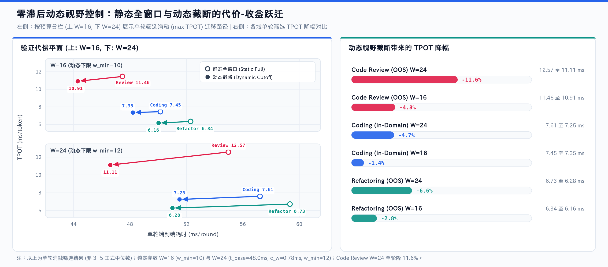
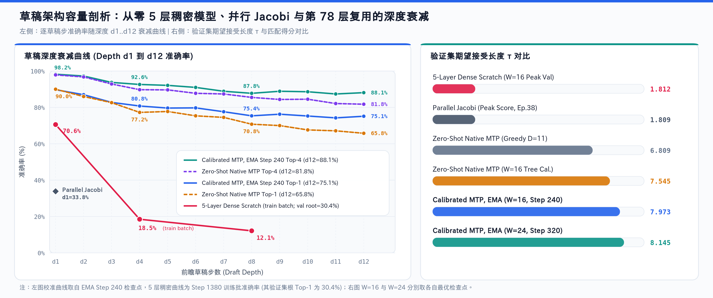
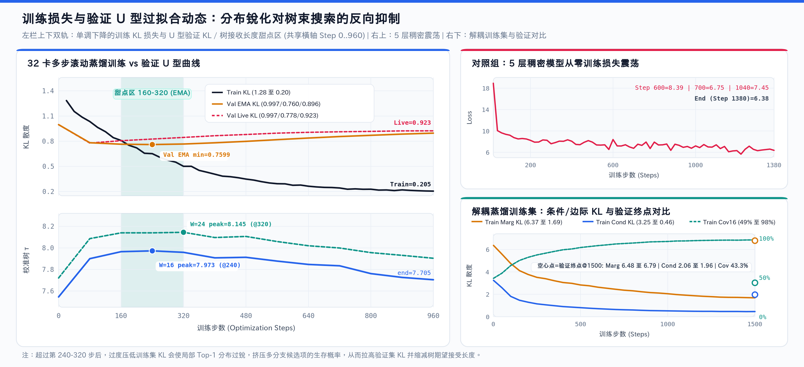
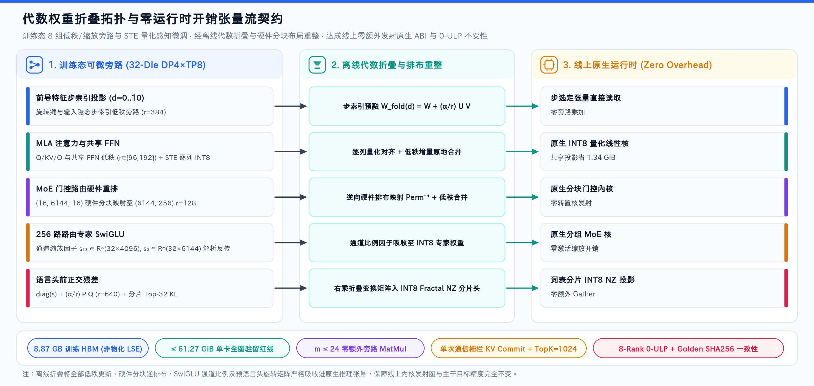
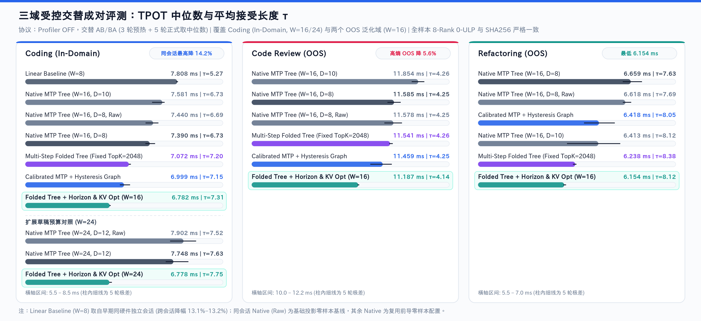
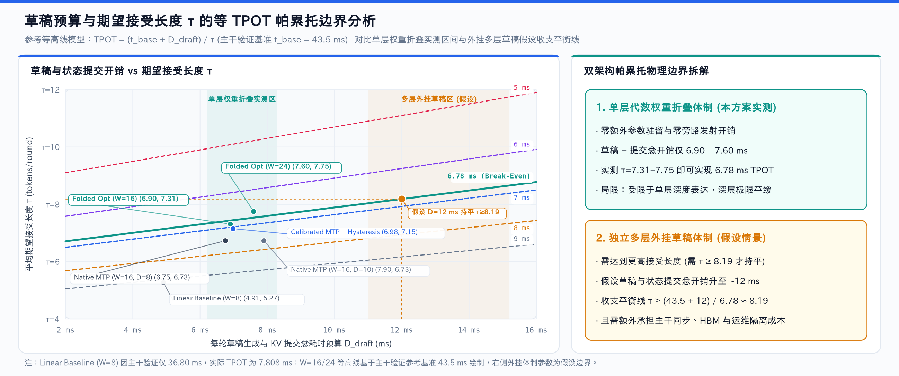

# 以边际为界的投机树解码：W4A8C8 MoE 模型单流极低时延推理的片上执行与零开销草稿折叠

## 摘要

批量为一的单流解码几乎不受算力限制，而受 HBM 带宽限制：W4A8C8 量化、TP8+EP8 部署的 MoE+MLA+SFA 模型每产出一个 token，都要把本轮激活的权重从 HBM 读一遍。投机解码用一次并行验证摊薄这次读取，但在 MoE 上验证并不免费。W 个待验 token 激活的专家并集随 W 扩大，实测验证阶段每增加一个树节点约多花 0.78–0.85 ms。单 token 延迟因此服从 $\mathrm{TPOT}(W)=(t_{\mathrm{base}}+c_w W)/\tau(W)$：只有接受长度 $\tau$ 的相对增益超过轮耗时的相对增长，加宽草稿树才有收益。高熵负载的树尾节点接受概率很低，盲目加宽反而更慢。

围绕这条边际不等式，我们设计了四个相互配合的机制。第一，片上三阶段树执行：种子打包、动态 beam 展开、树掩码与 RoPE 布局全部在设备端完成，每轮主机同步不超过 0.20 ms；单屏障单边 KV 提交把提交阶段从 1.409 ms 压到 1.290 ms。第二，零滞后边际视野控制：用本轮草稿路径概率预测 $\mathbb{E}[\tau(w)]$，按锁定的仿射代价曲线在验证前截断树宽，并给出停止规则取得全局最优宽度的充分条件。第三，基于真机量化轨迹的多步树感知校准。第四，把低秩适配器代数折叠进量化权重，运行时零额外开销。

所有配置都满足 8 个 rank 上目标缓存 0-ULP 一致，三个任务域的输出 SHA-256 与基线逐字节相同。在同一会话的 AB/BA 交错配对评测中（3 次预热、5 次正式取中位数），代码生成域 W=16/24 的 TPOT 为 6.782/6.778 ms，原生 MTP 树为 7.390–7.581 ms（W=16）与 7.748–7.902 ms（W=24），配对降幅分别为 8.2–10.5% 与 12.5–14.2%。另一会话测得的线性基线为 7.808 ms，跨会话比较降幅约 13.1%–13.2%。域外代码评审为 11.187 ms（原生 11.578–11.854 ms），域外重构为 6.154 ms（原生 6.413–6.659 ms）。

## 1 引言与瓶颈定界

### 1.1 单流解码的物理约束

自回归解码每一步都要完整走一遍前向。批量为一时，每读入一个权重字节只服务一个 token。在 4 bit 权重下，一个权重参与一次乘加（2 FLOP）只占 0.5 字节，算术强度约为每字节 4 FLOP，比加速器数百 FLOP/字节量级的屋脊点低两个数量级。所以单步延迟近似等于"本步需读取的字节数除以 HBM 带宽"，算力基本闲置。

本文的目标模型有 78 层 Transformer，注意力为 MLA（压缩潜变量 512 维加解耦 RoPE 64 维），配合 SFA 稀疏注意力。FFN 为 256 个路由专家、每 token 激活 top-8 的 MoE，词表约 151K。部署采用 W4A8C8 量化（4 bit 权重、8 bit 激活、8 bit KV 缓存），注意力与稠密部分 8 路张量并行，专家 8 路专家并行，每个 rank 持有 32 个专家。

这种部署下，一轮前向的耗时由三部分构成。第一部分是与 token 数无关的固定开销：稠密与共享权重的扫描、每层张量并行所需的 all-reduce、专家并行所需的 dispatch 与 combine 通信、算子发射。第二部分是 KV 缓存读取：MLA 把每 token 每层压缩成 576 维潜变量，SFA 再把每个查询的注意范围限制在 TopK 个历史位置。第三部分是路由专家权重的扫描，也是投机解码必须正视的部分。

批量为一时，前两部分中的通信也受时延而非带宽约束。每层的 all-reduce 与专家 dispatch、combine 只搬运一个或几十个 token 的激活，消息很小，耗时主要来自同步与链路时延，78 层累积下来是一笔与 token 数基本无关的固定开销。这类场景不能靠合批来摊薄成本：交互式编程助手要求单个请求的逐 token 延迟尽量低，目标只能是单流 TPOT 本身。

本文在三个任务域上评测。代码生成是草稿器校准数据所在的域内任务。代码评审是域外高熵任务，输出以自由文本评论为主，每轮接受长度约 4–4.4。代码重构是域外结构化任务，大段代码被局部改写，接受长度约 7.4–8.8。每个任务域使用一条固定的 8192 token 提示，贪心生成 1024 个 token。主要结果采用同一会话内的 AB/BA 交错配对协议：各配置交替运行，3 次预热、5 次正式，关闭剖析，取正式运行的中位数。等价契约有两层，缺一不可：8 个 rank 上目标模型的 KV 缓存逐位一致；每个任务域内所有配置的输出 SHA-256 完全相同。

### 1.2 投机解码的收益账本

投机解码的出发点很直接：既然读一遍权重的代价主要是访存，那就在一次读取中同时验证多个候选 token。Leviathan 等（2023）给出了基本账本：若每个草稿 token 的接受率为 $\alpha$、一次提出 $\gamma$ 个草稿 token，则每次验证期望产出 $(1-\alpha^{\gamma+1})/(1-\alpha)$ 个 token；若草稿与目标单步耗时之比为 $c$，墙钟加速比为 $(1-\alpha^{\gamma+1})/\big((1-\alpha)(\gamma c+1)\big)$。Chen 等（2023）独立提出了投机采样，用修正的拒绝采样保证输出分布与目标模型严格一致。在贪心解码下，这一机制退化为逐 token 精确匹配，构成本文等价契约的 token 层。契约更严的一层是 0-ULP：8 个 rank 上目标模型的 KV 缓存必须逐位一致。两层合起来，草稿策略只能改变速度，不能改变目标模型计算中的任何一个比特。

SpecInfer（Miao 等，2024）把单链草稿推广为 token 树，并用拓扑感知的因果掩码在一次前向中验证整棵树：多个分支同时竞争，提高被接受的期望长度。EAGLE-2（Li 等，2024）进一步观察到草稿模型的置信度可以近似接受率，据此按上下文动态扩展草稿树。Sequoia（Chen 等，2024）则把树的规模与形状交给面向硬件的优化器决定。DeepSeek-V3 的多 token 预测（MTP）模块为同架构模型提供了天然的单层草稿器，本文的草稿器也从这里出发。

Leviathan 等的账本隐含一个前提：目标模型验证 $\gamma+1$ 个 token 与验证 1 个 token 耗时相同。对访存受限的稠密模型这近似成立，因为多出的 token 只增加计算、不增加读取。本文场景与这一账本有两处不同，方向相反。

其一，草稿代价几乎可以忽略。MTP 草稿器只有一层，实测每个草稿步约 0.65 ms（原生树深度 10 时为 6.50 ms，深度 8 时为 5.30 ms），而一次验证约 43.5 ms，比值 $c\approx 1.5\%$，与"1 层对 78 层"的结构比例相符。

其二，验证代价随宽度增长。每个 token 从 256 个专家中选 8 个；在独立均匀路由的理想化假设下，$W$ 个 token 激活的专家并集期望为

$$\mathbb{E}[U(W)] = 256\left[1-\left(1-\tfrac{8}{256}\right)^{W}\right],$$

$W=1,8,16,24$ 时分别约为 8、57.4、102.0、136.5 个。每多一个被激活的专家，就要多读一份专家权重；在专家并行下，最慢的 rank 决定整轮时长。实测验证阶段耗时从线性链 $W=8$ 的 36.80 ms，增至原生树 $W=12$ 的 39.55–39.73 ms、$W=16$ 的 43.31–43.62 ms，以及 $W=24$ 静态满宽的 49.97 ms，跨会话拟合平均每节点 0.82 ms。

这两点合起来，把 Leviathan 账本里起决定作用的项从草稿代价换成了验证宽度。

### 1.3 边际不等式

把一轮的耗时拆开：

$$t(W) = \underbrace{t_v^{0}(k) + c_w W}_{\text{验证}} + \underbrace{c_d D}_{\text{草稿}} + t_c + t_s .$$

$t_v^{0}(k)$ 是验证的固定部分，原则上依赖 SFA 的 TopK 预算 $k$。$c_w$ 是每个树节点的验证边际代价，$c_d$ 是每个草稿步的代价，$D$ 是草稿深度。$t_c$ 是 KV 提交与下一轮种子准备，$t_s$ 是主机与设备的同步。固定深度时，把与 $W$ 无关的项合并为 $t_{\mathrm{base}}(k)$，得到

$$\mathrm{TPOT}(W) = \frac{t_{\mathrm{base}}(k) + c_w W}{\tau(W)} ,$$

其中 $\tau(W)$ 为每轮期望产出的 token 数（含验证时额外得到的一个 token）。把宽度从 $W$ 加到 $W'$ 有收益，当且仅当

$$\frac{\tau(W')}{\tau(W)} > \frac{t_{\mathrm{base}}(k) + c_w W'}{t_{\mathrm{base}}(k) + c_w W} .$$

即接受长度的相对增益必须超过轮耗时的相对增长。取连续极限，条件为 $\mathrm{d}\ln\tau/\mathrm{d}W > c_w / t(W)$。按 $t\approx 50$ ms、$c_w\approx 0.8$ ms 估算，每加一个节点，$\tau$ 至少要涨约 1.6% 才划算。

这个条件也可以落到单个节点上。若树中每个节点 $v$ 被接受的概率为 $a(v)$，由期望的线性性有 $\mathbb{E}[\tau] = 1 + \sum_v a(v)$：贪心验证下每层至多一个节点被接受，被接受节点数的期望就是各节点接受概率之和。于是加入节点 $v$ 使期望 $\tau$ 增加 $a(v)$、使轮耗时增加 $c_w$，加入它有收益当且仅当

$$a(v) > \frac{c_w}{\mathrm{TPOT}(W)} .$$

这个阈值有直接的物理含义：节点的接受概率必须超过"一个节点的验证代价"与"当前每 token 延迟"之比。按 $c_w = 0.78$ ms 计，代码生成域（TPOT 约 6.8 ms）的阈值约为 0.115，代码评审域（TPOT 约 11.2 ms）约为 0.070。

评审域的阈值更低，但它的接受长度只有约 4.2，即 16 个节点的接受概率之和只有约 3.2。概率集中在主干路径的前几层，大量树尾节点仍落在阈值之下。原生 MTP 树按固定形状展开，不检查这一条件，加宽就意味着为大量负收益节点付费。

这一视角也说明了树为什么优于链，以及控制粒度为什么应落在节点而非层上。在独立同分布的理想化模型中，若每个草稿 token 的接受率为 $\alpha$，单链第 $n$ 个草稿位置的接受概率为 $\alpha^{n}$，按几何级数衰减；单链的最优长度满足 $\alpha^{n} > c_w/\mathrm{TPOT}$，即 $n^{\ast} = \lfloor \ln(c_w/\mathrm{TPOT}) / \ln\alpha \rfloor$。链尾的几何衰减一旦跌破阈值，再加长就没有意义；而浅层的次优分支，其接受概率等于父路径概率乘以次优候选的条件概率，往往仍高于深层链尾。树把这些分支纳入候选，允许在全体候选中按接受概率挑选节点。按层设定固定 beam 宽度只是对这一选择的粗糙近似：同一层内的节点，其接受概率可以相差一个数量级。

实测数据把这一推导坐实了。在同一会话的配对评测中，原生 MTP 树从 $W=16$（深度 10）加宽到 $W=24$（深度 12）后，代码生成域的 $\tau$ 从 6.73 升到 7.63（+13.4%），TPOT 却从 7.581 ms 恶化到 7.748 ms（+2.2%）。逐配置单次筛选运行（静态满宽、TopK=1024）中，三个域从 $W=16$ 加宽到 $W=24$ 的结果如下：

| 任务域 | $\tau$ 增幅 | 每轮耗时增幅 | TPOT 变化 |
| --- | --- | --- | --- |
| 代码生成 | +11.77% | +14.08% | +2.07% |
| 代码评审 | +5.55% | +15.82% | +9.72% |
| 代码重构 | +6.90% | +13.46% | +6.14% |

三个域都不满足边际不等式，熵最高的评审域偏离最大。宽树本身没有错，错在把所有节点无差别地送去验证。

表 1 给出代码生成域三种配置的单轮分阶段耗时，均来自同一测量会话。$t_v$ 为验证，$t_d$ 为草稿展开，$t_c$ 为 KV 提交与种子准备，$t_s$ 为主机同步，$t_{\mathrm{round}}$ 为无剖析时的端到端每轮耗时。各阶段计时来自单独的分阶段测量，其和比 $t_{\mathrm{round}}$ 高 0.65–1.32 ms。三列依次为线性链基线（$W=8$）、原生 MTP 树（$W=16$，深度 10）与经过校准、采用滞回双图切换的 MTP 树（$W=16$）。

| 量 | 线性链 $W=8$ | 原生树 $W=16$ | 校准树 $W=16$ |
| --- | --- | --- | --- |
| $t_v$ (ms) | 36.798 | 43.492 | 43.687 |
| $t_d$ (ms) | 3.669 | 6.500 | 4.876 |
| $t_c$ (ms) | 1.240 | 1.399 | 1.281 |
| $t_s$ (ms) | 0.173 | 0.185 | 0.186 |
| $t_v$ 占比 | 87.8% | 84.3% | 87.3% |
| $t_{\mathrm{round}}$ (ms) | 41.171 | 50.946 | 48.726 |
| $\tau$ | 5.273 | 6.820 | 6.866 |
| TPOT (ms) | 7.808 | 7.470 | 7.097 |

表 1 显示三个事实。验证始终占单轮的 84–88%，这是 HBM 扫描在投机解码中的直接体现。从 $W=8$ 到 $W=16$，验证增加 6.69 ms，接近草稿阶段总耗时；校准树把草稿阶段从 6.50 ms 压到 4.88 ms，但验证阶段几乎不变。主机同步只占 0.4%，已不构成瓶颈（第 2 节）；剩下的大项只有验证宽度。

### 1.4 贡献

把瓶颈定界为"验证宽度的边际代价"之后，系统设计的目标就清楚了：在满足 0-ULP 等价的前提下，让每轮送去验证的每个节点都满足边际不等式，同时让 $\tau(W)$ 曲线本身尽量抬高。本文的贡献如下。

第一，片上零同步树执行引擎（第 2 节）。针对 Cube 与 Vector 分离、缺少 L0C 到 UB 直通路径的硬件约束，把种子打包、动态 beam 展开、树掩码与 RoPE 布局全部放在设备端，每轮主机同步不超过 0.20 ms。单屏障单边 KV 提交把树提交开销压到接近线性链的下界。

第二，零滞后边际视野控制（第 2 节）。用本轮草稿路径概率直接预测 $\mathbb{E}[\tau(w)]$，在验证前按锁定的仿射代价曲线截断树宽，并给出停止规则取得全局最优宽度的充分条件。在单次筛选中，高熵评审域 $W=24$ 的 TPOT 由此下降 11.6%。

第三，草稿容量分析与真机量化轨迹上的多步树感知校准（第 3、4 节），说明复用主干第 78 层的 MTP 草稿器为何胜过从零训练的多层稠密草稿器，以及验证 KL 的 U 型过拟合如何影响树的存活。

第四，零运行时开销的代数权重折叠与数值不变性契约（第 5 节），以及受控配对评测与帕累托上限讨论（第 6 节）。

在同一会话的 AB/BA 交错配对评测中，代码生成域 $W=16$ 的 TPOT 为 6.782 ms（$\tau=7.31$），$W=24$ 为 6.778 ms（$\tau=7.75$）。宽度加大使 $\tau$ 提高 6.0%，TPOT 基本持平（−0.06%）：边际控制把"加宽"从一项风险变成了一个中性选择，原生树在同样加宽下 TPOT 恶化 2.2%。

| 配置 | $W$ | $\tau$ | TPOT (ms) |
| --- | --- | --- | --- |
| 原生 MTP 树，深度 8 | 16 | 6.73 | 7.390 |
| 原生 MTP 树，深度 10 | 16 | 6.73 | 7.581 |
| 原生 MTP 树，深度 12 | 24 | 7.63 | 7.748 |
| 折叠树 + 视野与 KV 优化 | 16 | 7.31 | 6.782 |
| 折叠树 + 视野与 KV 优化 | 24 | 7.75 | 6.778 |

上表全部来自同一会话的配对评测；三个任务域的完整结果见第 6 节。

## 2 片上零同步执行引擎与零滞后视野控制

### 2.1 硬件约束：分离的 Cube 与 Vector，以及缺失的直通路径

目标硬件为昇腾 Ascend 910 系列（9392 型号）。它的 AI Core 采用 Cube 与 Vector 分离的设计：矩阵乘在 Cube 核上完成，结果累加在 L0C 缓冲；归一化、softmax、TopK、打分等逐元素与归约操作在 Vector 核上完成，操作数位于统一缓冲（UB）。这一型号没有从 L0C 直达 UB 的数据通路，矩阵乘的输出必须先经 FixPipe 写出到全局内存（经由 L2），再由 Vector 核读入 UB。

这条约束决定了草稿循环的写法。一个草稿步的核心是"MTP 层前向、LM head 投影、TopK 选择、分数更新"，后两步都是紧跟矩阵乘的向量操作。若把整行 logits 一次写回全局内存再统一处理，$m$ 行（$m \le 24$）乘以词表分片宽度的中间张量会在每个草稿步往返一次 HBM。我们把 LM head 投影按词表维度切片，让 Cube 核写出第 $j$ 片时 Vector 核处理第 $j-1$ 片，两者通过跨核同步标志衔接；Vector 核对每行维护运行中的 top-$b$ 候选与对数配分函数。后者不可省略：校准打分需要归一化的条件概率 $q(v) = \exp(\ell_v - \mathrm{LSE})$，只保留 top-$b$ 的原始 logit 无法得到它。这两个量都可以分片在线合并：对数配分函数满足 $\log\sum_j e^{\ell_j} = \mathrm{LSE}(\mathrm{LSE}_1,\dots,\mathrm{LSE}_J)$，全局 top-$b$ 必然包含在各片 top-$b$ 的并集中。所以显式分片中转不改变任何数值语义，只是把中间结果的驻留范围限制在 L2 可容纳的规模。

同样的结论适用于跨 rank 的词表分片。8 个 rank 各持约 1/8 的词表，每行的全局 top-$b$ 只需交换 $8b$ 个局部候选及其局部对数配分函数，就能精确合并，不必汇集完整 logits。

第二条约束来自主机与设备的交互。若由主机驱动草稿循环，每个草稿步结束时主机都要读回 TopK 索引来构造下一步输入，一轮 $D$ 步就有 $D$ 次设备到主机的同步，每次都包含拷贝、等待与重新发射的气泡。树的构造、宽度决策、掩码生成同样需要读回中间结果。我们的原则是：一轮之内主机不读取任何中间结果。所有控制信息（候选索引、父指针、分数、截断宽度、位置编码、注意力掩码）都由设备端算子写入固定容量的缓冲区，主机只负责按序发射，每轮仅在末尾读回本轮被接受的 token 用于流式输出。表 1 中 $t_s$ 为 0.173–0.186 ms，后文筛选中的配置为 0.140–0.200 ms，均不到单轮的 0.4%。

### 2.2 三阶段片上树执行

每轮解码由三个设备端阶段和一次验证组成，阶段之间只通过设备内存传递数据。

阶段一是种子打包。上一轮验证结束后，被接受路径的末节点及其隐藏状态 $h$、验证额外产出的 token $x^{\ast}$ 都已位于设备内存。MTP 草稿器的输入是对归一化后的 $h$ 与 $\mathrm{Emb}(x^{\ast})$ 做拼接投影。种子打包按被接受路径的索引从验证输出中收集 $h$，与 $x^{\ast}$ 的嵌入一起写入草稿器的固定输入槽位。这一步只做收集与拷贝，实测 0.008–0.02 ms。

阶段二是动态 beam 展开。草稿器按深度逐步展开，深度 $d$ 保留 $b_d$ 个节点，形成 beam 宽度序列 $(b_1,\dots,b_D)$。例如 $W=16$ 时使用的三档序列为 $(4,4,4,2,2)$、$(4,4,4,4,4,2,2)$ 与 $(4,4,4,4,2,2,2,2,1,1,1)$，候选池大小 $N=\sum_d b_d$ 分别为 16、24 与 27。每个深度上，前沿节点作为 $m\le 24$ 行一次送入草稿器（权重随步号索引，见第 5 节），经 LM head 与 2.1 节的分片 TopK 得到每个前沿节点的 top-$b$ 子节点，再按累积分数保留 $b_{d+1}$ 个。

这一设计借鉴了 EAGLE-2（Li 等，2024）的观察：草稿置信度可以近似接受率。差别在于用途。EAGLE-2 只需要分数的相对顺序来决定扩展哪些节点；本文的视野控制器（2.5 节）还需要一个有绝对尺度的量来预测期望接受长度。所以每个节点携带两个量。一是路径概率 $\hat a(v) = \exp(\mathrm{clip}(s(v), -20, 0))$，$s(v)$ 为路径上草稿条件对数概率之和，用作接受概率的估计。二是树效用 $g_{\beta}(v)$，在 $s(v)$ 之上加入头部间隔与深度两项修正，参数 $\beta=(\beta_{\mathrm{margin}},\beta_{\mathrm{depth}})$ 在真机量化轨迹上拟合（第 4 节），只用于决定哪些节点进入 beam，以及截断时节点的先后顺序。

阶段三是树与 RoPE 布局构造。从候选池中按 $\hat a$ 降序取前 $w^{\ast}$ 个节点（$w^{\ast}$ 由 2.5 节给出），按深度重排为广度优先顺序，生成父指针数组与祖先掩码 $M_{ij} = \mathbb{1}[\,j \text{ 是 } i \text{ 的祖先或自身}\,]$。节点 $i$ 的位置编号为 $p_i = L + \mathrm{depth}(i)$，$L$ 为已提交前缀长度，同一深度的兄弟节点共享位置编号。MLA 的解耦 RoPE 分量（64 维）按 $p_i$ 旋转，SFA 的索引器对每个树节点在"前缀加其祖先"的范围内选取 TopK 位置。整棵树与前缀拼接后一次送入目标模型验证，贪心比对得到最长匹配路径及额外 token。

线性链是这一流程的特例：每层 $b_d = 1$，被接受路径天然连续。树的情形下，被接受路径上的节点散布在树槽位中，需要在提交时压实。

三个阶段使用的所有缓冲区，都按候选池与树宽的上限预先分配：候选索引、父指针、分数、位置编号与掩码的形状每轮不变，超出本轮实际规模的部分以掩码屏蔽。这样，草稿与布局算子的形状在整个解码过程中保持静态，可以预先捕获为计算图，也不会触发运行时的内存分配。验证则按截断后的宽度执行；正是这一点让截断直接反映到验证耗时上（2.5 节）。

### 2.3 单屏障单边 KV 提交

验证时，目标模型把所有树节点的 KV 潜变量写在前缀之后的 $w^{\ast}$ 个槽位中。被接受的路径每层恰有一个节点，按广度优先顺序其槽位单调递增，但未必连续。提交阶段要把这些槽位搬到前缀之后的连续位置，覆盖 78 层目标缓存、草稿层缓存以及下一轮的种子输入。被接受路径恰好是每层排序第一的节点时无需搬移，线性链的提交就属于这种情况，压实轮数恒为零。

直接实现中，提交被拆成若干先后依赖的子步骤（索引计算、各类缓存的收集与写回、种子更新），子步骤之间各有一次跨 rank 同步，以保证读到的是其他 rank 已完成的结果。注意到压实的源与目标位置完全由被接受路径的索引决定，而这份索引在验证后已复制到每个 rank，每个 rank 都能独立计算出自己本地分片的全部搬移，不需要读取其他 rank 的数据。于是提交可以改写为：每个 rank 对本地分片执行单边写入，全体 rank 只在提交末尾经过一次屏障，确保下一轮读取前所有写入已落地。

压实还可以原地完成，不需要临时缓冲。设被接受路径的第 $i$ 个节点位于槽位 $s_i$，目标位置为 $L+i$。由于 $s_i$ 严格递增且 $s_0 \ge L$，有 $s_i \ge L+i$。按 $i$ 递增的顺序搬移时，写入位置 $L+i$ 不超过源位置 $s_i$，且对任意 $j > i$ 有 $s_j > s_i \ge L+i$，因此写入不会覆盖尚未读取的源数据。

在其余条件相同的两次筛选运行中（固定 TopK=2048、静态宽度 16），提交阶段从 1.409 ms 降到 1.290 ms（−8.4%），已接近线性链基线 1.240 ms 的下界。这一收益的绝对值不大，与各配置间提交阶段的测量离散（1.25–1.53 ms）同一量级；它的价值在结构上：提交阶段不再随同步点数量增长。

### 2.4 SFA TopK 预算对齐

SFA 以索引器为每个查询选出 TopK 个历史位置参与注意力。目标模型的 TopK 预算是模型定义的一部分：上下文超过预算后，改变它就会改变目标分布，违反 0-ULP 契约。所以 TopK 对齐只能施加于草稿层。

草稿器训练时对稀疏注意力窗口做了随机化，窗口取自 $\{512, 1024\}$（第 4 节）。推理时若草稿层沿用 2048 的预算，它看到的注意范围就超出了训练分布。我们把草稿层的 TopK 设为 1024，使推理与训练时的稀疏模式一致。

这项对齐不降低验证耗时。在静态宽度 16 下，TopK 取 2048、1024、512 时验证阶段分别为 43.152、43.205、43.109 ms，差异在测量离散之内，与"验证作用于目标模型、目标配置不变"一致。它对端到端延迟的影响也随任务域而异：从 2048 改为 1024 后，重构域 TPOT 从 6.506 降至 6.339 ms（$\tau$ 从 7.93 升至 8.25），代码生成与评审域则分别从 7.387、11.244 ms 变为 7.452、11.460 ms。后文表 2 中验证阶段 1.58 ms 的下降（43.205 降至 41.621 ms），来自 2.5 节的动态宽度截断，而非 TopK 预算。

### 2.5 从滞后的 EMA 滞回到零滞后边际视野控制

#### 2.5.1 滞回控制器的滞后

把边际不等式落到运行时，最直接的做法是根据近期的接受长度切换树形。较早的配置预先准备紧凑与完整两套树形计算图，用接受长度的指数滑动平均 $\bar\tau_t = (1-\alpha)\bar\tau_{t-1} + \alpha\,\tau_{t-1}$ 驱动切换，并设置上下阈值形成滞回以免振荡；后续扩展为三档。三档控制器取 $\alpha = 0.28$，阈值为 4.9、5.5 与 7.2，另有基于单轮极端值与连续计数的快速跳变规则。

这类控制器的根本问题是滞后：第 $t$ 轮的决策只能使用第 $t-1$ 轮及之前的信息。EMA 对阶跃变化的响应为 $1-(1-\alpha)^n$，$\alpha = 0.28$ 时要 2.1 轮才能完成一半响应，7.0 轮才能完成 90%。生成内容在模板代码、自由文本注释与结构化改写之间切换时，控制器会在错误的树形上运行若干轮，而这几轮恰恰是边际不等式偏离最大的时候。加大 $\alpha$ 能缩短滞后，但会把单轮的随机波动直接传到树形选择上，滞回阈值就是为抑制这种波动而设。滞后与噪声之间的折中，在历史驱动的框架里无法消除。

#### 2.5.2 零滞后的期望接受长度预测

决定宽度所需的信息，其实在本轮之内就已存在。阶段二结束时，候选池中每个节点都有路径概率 $\hat a(v)$ 与树效用 $g_{\beta}(v)$，验证还没有开始。把候选按 $g_{\beta}$ 降序排列为 $v_{(1)},\dots,v_{(N)}$，记 $\hat a_{(i)} = \hat a(v_{(i)})$，前缀和 $S(w) = \sum_{i\le w}\hat a_{(i)}$。由 1.3 节的线性性，截断到前 $w$ 个节点时本轮的期望接受长度为

$$\widehat{\mathbb{E}}[\tau(w)] = 1 + S(w) .$$

配合仿射代价模型 $\hat t(w) = \hat t_0 + \hat c\, w$，本轮的宽度决策为

$$w^{\ast} = \arg\min_{w_{\min}\le w\le W} \hat f(w), \qquad \hat f(w) = \frac{\hat t_0 + \hat c\, w}{1 + S(w)} .$$

这个决策只依赖本轮数据，不存在历史滞后。下面两个命题说明：截断后仍是一棵合法的树；一次线性扫描即可求解，并在 $\hat a$ 沿排序不增时给出精确最优。

命题 1（截断保持树结构）。若排序分数 $r$ 对每个节点 $v$ 及其父节点 $u$ 满足 $r(v) \le r(u)$，且相同分数时深度较小者优先，则按 $r$ 降序取出的任意前 $w$ 个节点构成一棵包含根的子树。

证明：设某节点 $v$ 被选中而其父节点 $u$ 未被选中，则 $r(u) \ge r(v)$ 且 $u$ 深度更小，按排序规则 $u$ 必然排在 $v$ 之前，矛盾。命题的前提是排序分数沿路径不增。路径对数概率 $s(v)$ 每向下一层加上一个非正的条件对数概率，自然满足；树效用 $g_{\beta}$ 则需要其两项修正不破坏这一性质，或者逐节点取 $g_{\beta}(v) \leftarrow \min\{g_{\beta}(v), g_{\beta}(\mathrm{parent}(v))\}$ 强制满足。后一种做法只压低少数违反单调性的子节点，不改变其余节点之间的相对顺序。

命题 2（边际停止规则）。对任意排序与任意 $w$，有 $\hat f(w+1) < \hat f(w)$ 当且仅当 $\hat a_{(w+1)}\,\hat f(w) > \hat c$。若 $\hat a_{(i)}$ 沿排序不增，则一旦某个 $w^{\circ}$ 使该条件不成立，对所有 $w \ge w^{\circ}$ 均不成立。所以 $\hat f$ 在 $[0, w^{\circ}]$ 上单调不增、在 $[w^{\circ}, N]$ 上单调不减，约束问题的解为 $w^{\ast} = \min\{W, \max\{w_{\min}, w^{\circ}\}\}$。

证明：记 $A = \hat t_0 + \hat c\,w$，$B = 1 + S(w)$，$a = \hat a_{(w+1)}$。$\hat f(w+1) < \hat f(w)$ 即 $(A+\hat c)B < A(B+a)$，化简为 $\hat c B < A a$，即 $a\,\hat f(w) > \hat c$。若该条件在 $w$ 处不成立，则 $\hat f(w) \le \hat c/a$。$\hat f(w+1) = (A+\hat c)/(B+a)$ 是 $A/B$ 与 $\hat c/a$ 的中间分数，必介于两者之间，故 $\hat f(w+1) \le \hat c/a$。又由单调性 $\hat a_{(w+2)} \le a$，有 $\hat a_{(w+2)}\,\hat f(w+1) \le a\cdot\hat c/a = \hat c$，条件在 $w+1$ 处仍不成立。归纳即得。

命题 2 是 1.3 节节点级阈值 $a(v) > c_w/\mathrm{TPOT}$ 的精确离散形式：沿排序逐个加入节点，第一次遇到接受概率低于"代价斜率除以当前预测延迟"的节点就停止。命题 2 的第一部分对任意排序成立，所以停止之前每加入一个节点，$\hat f$ 都严格下降。$\beta = 0$ 时树效用与路径概率同序，第二部分的单调条件成立，停止点就是全局最优。$\beta \ne 0$ 时，$g_{\beta}$ 排序下的 $\hat a$ 未必单调，停止规则成为贪心规则：它保证截断后的 $\hat f$ 不高于任何更早停止的结果，但可能错过排在停止点之后、路径概率更高的节点。决策代价是对至多 $N\le 29$ 个数的排序、前缀和与一次扫描，在设备端并入阶段三。实测启用截断后草稿阶段反而从 5.805 ms 降到 5.597 ms，看不到额外开销。

代价曲线按最大宽度分别锁定，$W=16$ 与 $W=24$ 各一组；$W=24$ 时取 $\hat t_0 = 48.0$ ms、$\hat c = 0.78$ ms。由 $\hat f/\hat c = (\hat t_0/\hat c + w)/(1+S(w))$ 可知，最优宽度只依赖比值 $\hat t_0/\hat c$，这里约为 61.5 个节点当量。$\hat c = 0.78$ ms 与 1.2 节实测的每节点验证代价（平均 0.82 ms）相符。

锁定而不在线估计代价曲线有两个理由。在线估计需要在设备端计时并回传，重新引入本节要消除的同步。更重要的是，锁定参数使宽度决策只取决于本轮的设备数据，给定输入即可完全复现。

宽度下限 $w_{\min}$ 用于限制概率估计误差的影响。若路径概率系统性地偏离真实接受概率，$\hat a = \lambda a$，代入命题 2 的条件 $\lambda a(\hat t_0 + \hat c w) > \hat c\,(1 + \lambda S)$，整理得 $a(\hat t_0+\hat c w) > \hat c\,(1/\lambda + S)$。过度自信（$\lambda > 1$）降低保留门槛，树偏宽，多付验证代价；信心不足（$\lambda < 1$）抬高门槛，树偏窄，把本会被接受的节点剪掉。后一种误差直接损失 $\tau$，代价更大，宽度下限正是针对它的保护。截断决策在小宽度区间最敏感：$\hat a$ 稍有偏差，就可能剪掉真正会被接受的节点，而这一损失要整轮承担。筛选结果表明，下限过低时高熵域受损：$W=16$ 下 $w_{\min}$ 从 10 降到 8，评审域 TPOT 从 10.912 升至 11.071 ms，$\tau$ 从 4.06 降至 3.965；$W=24$ 下 $w_{\min}=12$ 优于 $w_{\min}=10$（评审域 11.115 对 11.367 ms）。

#### 2.5.3 两个时间尺度

零滞后控制并未完全取代历史驱动的控制，而是按信息何时可得来分工。草稿深度（即选用哪一档 beam 序列）必须在展开开始前确定，那时本轮还没有任何分数，只能依据历史，仍由三档滞回控制器决定。树宽在展开之后、验证之前确定，本轮分数已经可得，由零滞后规则决定。

这一分工与代价结构吻合。深度只影响草稿阶段，每步约 0.65 ms；宽度直接作用于占单轮 84–88% 的验证阶段，每节点约 0.8 ms，且整棵树的规模由它决定。把滞后留在代价较小的维度上，把精确控制用在代价最大的维度上。也可以每轮都按最深的序列展开、再由零滞后规则截断，从而完全去掉深度上的历史依赖，但这样做代价明显。草稿步是串行的，原生树深度从 8 增至 10，草稿阶段就从 5.30 ms 增至 6.50 ms；三档序列的步数为 5、7、11，若每轮固定展开 11 步，原本选用 5 步或 7 步序列的轮次将各多付约 3.9 或 2.6 ms 草稿时间（按每步 0.65 ms 计）。深度的预测性决策省下的是这笔串行代价。

#### 2.5.4 筛选结果与端到端收益

表 2 汇总逐配置单次筛选运行的结果，用于定位各机制的作用（数值为单次运行，非配对中位数）。$k$ 为草稿层 TopK 预算，$w_{\min}$ 为宽度下限，$w_{\min}$ 等于最大宽度即静态满宽；提交与验证阶段在代码生成域测得。

| 配置 | $W$ | $k$ | $w_{\min}$ | 提交 (ms) | 验证 (ms) | 代码 TPOT | 评审 TPOT | 重构 TPOT |
| --- | --- | --- | --- | --- | --- | --- | --- | --- |
| 多步折叠树，多同步提交 | 16 | 2048 | 16 | 1.409 | 43.209 | 7.427 | 11.399 | 6.483 |
| 加单屏障提交 | 16 | 2048 | 16 | 1.290 | 43.152 | 7.387 | 11.244 | 6.506 |
| 加草稿 TopK 对齐 | 16 | 1024 | 16 | 1.290 | 43.205 | 7.452 | 11.460 | 6.339 |
| 加零滞后截断 | 16 | 1024 | 10 | 1.302 | 41.621 | 7.350 | 10.912 | 6.162 |
| 下限放宽 | 16 | 1024 | 8 | 1.400 | 41.443 | 7.335 | 11.071 | 6.151 |
| 去掉分数校准 | 16 | 1024 | 10 | 1.250 | 41.431 | 7.173 | 10.922 | 6.220 |
| 静态满宽 | 24 | 1024 | 24 | 1.327 | 49.969 | 7.606 | 12.574 | 6.728 |
| 加零滞后截断 | 24 | 1024 | 12 | 1.525 | 44.325 | 7.251 | 11.115 | 6.283 |
| 加零滞后截断 | 24 | 1024 | 10 | 1.378 | 44.024 | 7.234 | 11.367 | 6.300 |

截断的作用随熵增大而增强。$W=16$ 时，零滞后截断使代码生成、评审、重构三域 TPOT 分别下降 1.4%、4.8%、2.8%；$W=24$（$w_{\min}=12$）时分别下降 4.7%、11.6%、6.6%，评审域从 12.574 ms 降到 11.115 ms。最大宽度越大、负载熵越高，静态树中低于边际阈值的节点越多，截断回收的验证代价也越多。$W=24$ 静态满宽时验证为 49.97 ms，截断后为 44.33 ms，接近 $W=16$ 静态满宽的 43.2 ms，但候选池更大，可选的高概率节点更多。按 $\hat c = 0.78$ ms 换算验证耗时的降幅，代码生成域 $W=24$ 每轮比静态配置平均少验证约 7.2 个节点，$W=16$（$w_{\min}=10$）平均少约 2.0 个节点。这是由验证耗时反推的估计，但足以说明：最大宽度越大，控制器剪掉的比例越高。

去掉树效用中的两项修正（$\beta = 0$）后，结果方向并不一致：代码生成域 TPOT 低 2.4%，评审域持平（+0.1%），重构域高 0.9%。两种设定的取舍正对应上文的分析：$\beta = 0$ 时截断顺序与路径概率一致，停止规则精确最优，但节点排序只看路径概率；$\beta \ne 0$ 时排序吸收了在量化轨迹上拟合的间隔与深度信息，停止规则变为贪心。单次筛选不足以分辨这些差异是否显著。树效用的拟合过程见第 4 节。

回到同一会话的配对评测，从固定宽度的多步折叠树（TopK=2048）到加入视野与 KV 优化的完整配置，代码生成、评审、重构三域 TPOT 分别从 7.072、11.541、6.238 ms 降到 6.782、11.187、6.154 ms（−4.1%、−3.1%、−1.3%）。相对较早的校准滞回双图配置（6.999、11.459、6.418 ms），降幅为 3.1%、2.4%、4.1%。

配对评测还呈现出很强的运行间稳定性。多步折叠树的两种配置在 8 次运行中轮数完全相同（代码生成域分别为 142 与 140 轮），5 次正式运行的 TPOT 极差为 0.034 ms 与 0.019 ms。原生 MTP 树的轮数在 149–155 之间波动，TPOT 极差为 0.147–0.196 ms。输出 token 在所有运行中逐字节一致；轮数波动只来自草稿侧接受模式的差异，不触及目标输出。

#### 2.5.5 算法描述

算法 1 给出一轮解码的完整流程。除最后一行读回被接受的 token 外，所有步骤都在设备端执行，主机只按序发射。

\begin{algorithm}[t]
\SetAlgoLined
\DontPrintSemicolon
\KwIn{前缀长度 $L$；末节点隐藏状态 $h$；额外 token $x^{\ast}$；beam 序列 $(b_1,\dots,b_D)$；校准函数 $g_{\beta}$；锁定代价参数 $(\hat t_0,\hat c)$；宽度范围 $[w_{\min}, W]$}
\KwOut{被接受 token 序列 $y$；更新后的 $(L, h, x^{\ast})$}
\tcp{阶段一：种子打包}
$z_0 \leftarrow \mathrm{Proj}\big[\mathrm{Norm}(h);\,\mathrm{Norm}(\mathrm{Emb}(x^{\ast}))\big]$；$F_0 \leftarrow \{\text{root}\}$；$\mathcal{C} \leftarrow \emptyset$\;
\tcp{阶段二：动态 beam 展开}
\For{$d \leftarrow 1$ \KwTo $D$}{
  $Z_d \leftarrow \mathrm{Draft}_d(F_{d-1})$ \tcp*{$|F_{d-1}| \le 24$ 行，步号索引权重}
  $\mathcal{K}_d \leftarrow \mathrm{TopB}\big(\mathrm{Head}(Z_d)\big)$ \tcp*{词表分片在线 top-$b$ 与 LSE 合并}
  \ForEach{$v \in \mathcal{K}_d$}{ $s(v) \leftarrow s(\mathrm{parent}(v)) + \log q(v)$；$\hat a(v) \leftarrow \exp(\mathrm{clip}(s(v),-20,0))$；$r(v) \leftarrow g_{\beta}\big(s(v),\, m(v),\, d\big)$ }
  $F_d \leftarrow$ 按 $r$ 取 $\mathcal{K}_d$ 中前 $b_d$ 个；$\mathcal{C} \leftarrow \mathcal{C} \cup F_d$\;
}
\tcp{阶段三：零滞后视野截断与布局}
将 $\mathcal{C}$ 按 $r$ 降序排列为 $v_{(1)},\dots,v_{(N)}$（同分时深度小者优先）\;
$S \leftarrow 0$；$w^{\circ} \leftarrow N$\;
\For{$w \leftarrow 0$ \KwTo $N-1$}{
  \If{$\hat a(v_{(w+1)})\,(\hat t_0 + \hat c\,w) \le \hat c\,(1+S)$}{ $w^{\circ} \leftarrow w$；\textbf{break} }
  $S \leftarrow S + \hat a(v_{(w+1)})$\;
}
$w^{\ast} \leftarrow \min\{W, \max\{w_{\min}, w^{\circ}\}\}$；$T \leftarrow \{v_{(1)},\dots,v_{(w^{\ast})}\}$\;
按广度优先重排 $T$；$M_{ij} \leftarrow \mathbb{1}[j \preceq i]$；$p_i \leftarrow L + \mathrm{depth}(i)$\;
\tcp{验证与提交}
$(P, x^{\ast}, h) \leftarrow \mathrm{Verify}(T, M, p)$ \tcp*{贪心比对得最长匹配路径 $P$}
各 rank 对本地 KV 分片执行单边压实写入 $T[P] \to [L, L+|P|)$；\textbf{barrier}\;
$y \leftarrow (P, x^{\ast})$；$L \leftarrow L + |P| + 1$；读回 $y$\;
\caption{一轮片上树解码与零滞后边际视野控制}
\end{algorithm}

算法 1 中，$q(v)$ 为节点 $v$ 的草稿条件概率，$s(v)$ 为路径对数概率（根节点为 0），$m(v)$ 为其草稿分布的头部间隔，$r(v)$ 为树效用，$j \preceq i$ 表示 $j$ 是 $i$ 的祖先或自身。第三阶段的循环是命题 2 停止规则的直接实现：条件 $\hat a_{(w+1)}(\hat t_0+\hat c w) \le \hat c(1+S(w))$ 等价于 $\hat a_{(w+1)}\hat f(w) \le \hat c$，一旦成立即可停止。

至此，系统一侧的工作把每轮送去验证的节点限定在满足边际不等式的范围内，并把验证之外的开销（草稿、提交、同步）压到单轮的 12–15%。TPOT 的进一步下降，只能来自抬高 $\tau(w)$ 曲线本身，即提高每个候选节点的真实接受概率并让 $\hat a$ 如实反映它。第 3 节从草稿器的容量出发讨论这个问题。

## 3 草稿容量解剖：为何五层从零稠密模型败于复用主干第 78 层

第 2 节确立的片上零同步执行与零滞后视野控制将主机调度开销压缩至单轮不足 0.4%，并依据节点边际不等式裁剪尾部无效验证槽位。在此系统底座之上，单字有效时延方程 $\mathrm{TPOT}(w) = (\hat t_0 + \hat c\,w) / \tau(w)$ 的进一步下探取决于能否抬高 $\tau(w)$ 曲线本身的容量上界——即草稿模型在有限前向预算下所能维持的多步条件接受概率。在超低时延树投机架构选型中，主流轻量化路线主张脱离目标主干稀疏结构，从随机初始化训练独立的多层稠密（Dense）网络或并行多位置预测头；另一条路径则直接复用目标主干附带的原生第 78 层多词预测（MTP）模块（DeepSeek-AI, 2024）。将从零五层稠密训练、并行 Jacobi 解码与原生第 78 层热启置入同一验证基准对比，能够从流形几何、压缩缓存兼容与稀疏条件容量三方面定位前两者的失效机理，并识别原生第 78 层在多步自滚下的剩余偏差。

### 3.1 从零训练五层稠密草稿与并行 Jacobi 解码的容量坍塌

依照轻量独立草稿的常规设计，将主干中带有 256 选 8 稀疏路由的复杂层替换为结构规整的浅层稠密 Transformer，似乎既可规避动态路由带来的不规则访存，又能借助多层非线性堆叠获得优于单层的表示深度。为此，我们构建了一套五层从零初始化稠密草稿模型（5-Layer Dense-from-Scratch）：隐藏维 $d = 6144$，每层配置 32 个查询头与 8 个分组键值头（单头维度 128），SwiGLU 前馈中间维为 8192，并在各层之间注入邻接门控消息通路——将当前步与前一步隐藏态分别经投影矩阵映射至 1024 维转移子空间并实施 L2 归一化得 $\mathbf{z}_{\mathrm{cur}} = \mathrm{L2Norm}(W_{\mathrm{msg}}\mathbf{h}_{\mathrm{cur}})$ 与 $\mathbf{z}_{\mathrm{pred}} = \mathrm{L2Norm}(W_{\mathrm{msg}}\mathbf{h}_{\mathrm{pred}})$，再经 512 维门控函数 $\mathbf{g} = \sigma(W_q \mathbf{z}_{\mathrm{cur}} + W_p \mathbf{z}_{\mathrm{pred}} + \mathbf{b}_g)$ 与通道投影把前位消息注入当前残差流。依据上述维度计算，仅五层注意力与前馈主块便含约 1.070B 参数，叠加词嵌入与输出投影双表（154,880 $\times$ 6144 $\times$ 2，共约 1.903B）以及邻接门控与输入状态投影（约 0.200B）后，整网总参数量约 3.173B（可训练非词表部分约 1.269B）。训练接收目标主干第 77 层锚点隐状态，并通过课程退火机制（混合监督比例由第 20 步的 0.443 线性退火至第 1280 步的 0.0）拟合长上下文代码蒸馏样本。一旦课程比例降至零并完全转入纯自滚预测，早期微小的隐特征偏移即沿多层非线性堆叠逐层放大。

实测训练动态与验证树搜索表现均出现优化失稳与深步预测坍塌（图 3 与图 4 右上）。优化过程中，第 20 步训练总损失达 18.9160（隐状态 KL 散度 21.6544，嵌入头损失 4.8312，全局梯度范数 110.883）。第 600 步之后损失未能单调收敛，而是在高损失平台剧烈震荡：第 700 步下探 6.7512 后于第 760 步反弹至 7.9265，第 980 步回落至 6.7654 后又在第 1040 步与第 1100 步反弹至 7.4545 与 7.4069，第 1220 步短暂降至 5.6621 后仍在第 1260 步回升至 7.1427，至第 1380 步终态总损失停留在 6.3774，嵌入头损失停滞于 3.6982。

沿自回归展开步数 $d$ 的准确率衰减更为剧烈。第 1380 步训练批次评估显示，依赖真值锚点的第 1 步（$d=1$）预测准确率尚可达 70.57%（70.6%），一旦切入多步自滚，第 4 步（$d=4$）准确率即骤跌至 18.49%（18.5%），第 8 步（$d=8$）进一步降至 12.11%（12.1%）。置入留出验证集树搜索评测（图 3 右栏），两组独立训练运行在不同步数检查点下的 16 槽位单链接受长度仅为 1.43 至 1.58；开启多分支树检索后，$W=16$ 预算下的期望接受长度 $\tau$ 仍局限于 1.612 至 1.812 区间（组二第 1000 步为 1.612、第 1600 步为 1.746，组一第 800 步为 1.682、第 1200 步上限为 1.812；树宽扩至 $W=24$ 最高亦仅达 1.858），其留出验证根部候选 Top-1 准确率仅 26.2% 至 30.4%，Top-16 覆盖率仅 49.5% 至 54.6%。

为检验逐词串行暴露偏差是否为失利的唯一原因，我们进一步评测了并行多位置迭代路线——基于局部状态精化的并行 Jacobi 解码模型（Parallel Jacobi）。该架构围绕单步 SwiGLU 状态精化单元构建（中间维 4096，每轮执行 2 步微迭代，联合拼接隐状态、词嵌入与残差锚点三路 6144 维特征），在单轮内同步预测相邻双词位置 $(a, b)$：门控单元输出两路残差增量 $(\Delta_{\mathrm{rec}}, \Delta_{\mathrm{tok}})$，沿微迭代步按 $\mathbf{u}_{\mathrm{rec}}^{(k+1)} = \mathbf{h}_{\mathrm{cur}} + \boldsymbol{\alpha}_k \odot \mathbf{r}_{\mathrm{prev}} + s(\mathbf{h}_{\mathrm{cur}})\,\Delta_{\mathrm{rec}}$ 与 $\mathbf{u}_{\mathrm{tok}}^{(k+1)} = \mathbf{u}_{\mathrm{rec}}^{(k+1)} + s(\mathbf{u}_{\mathrm{rec}}^{(k+1)})\,\Delta_{\mathrm{tok}}$（$s(\cdot)$ 为均方根归一化放缩算子）交替更新状态并在单次输出头投影中读出相邻候选分布。经 44 个 Epoch 训练，训练损失由第 1 轮的 21.5127 平滑降至第 44 轮的 5.1740，然而验证集性能在第 34 至 42 轮即饱和于平台期：综合评估得分停留在 1.8053 至 1.8094（第 36 轮为 1.8053，第 44 轮为 1.8051），位置 $a$ 对目标分布的 Top-1 命中率平台期为 33.53% 至 34.22%（相对原生第 78 层参照为 35.66% 至 36.38%），位置 $b$ 为 29.91% 至 30.72%。并行状态同步缺乏逐词因果锚点传递，无法解析代码上下文中环环相扣的标识符拼写与类型约束依赖。

### 3.2 复用主干第 78 层 MTP 的结构同源优势与剩余短板

与上述两条路径形成对照，将主干附带的原生第 78 层 MTP 模块直接作为热启骨架接入同一验证集后，图 3 呈现出显著的起点优势。在未经任何微调的零样本（Zero-Shot）状态下，原生第 78 层第 1 步（$d=1$）Top-1 准确率即达 90.00%（Top-4 为 97.88%），第 4 步保持 77.25%，第 8 步仍有 70.75%，连续自滚至第 12 步（$d=12$）依然维持 65.75%（65.8%）Top-1 与 81.75%（81.8%）Top-4 覆盖率；对应的验证集单链贪心 $\tau$ 为 6.8087，$W=16$ 树未校准 $\tau$ 为 7.4550、经效用校准后达 7.5450（7.55），$W=24$ 校准后达 7.7213。再经第 4 节量化轨迹多步树感知蒸馏校准后，第 12 步准确率进一步提升至 75.12%（75.1%）Top-1 与 88.12%（88.1%）Top-4（第 240 步 EMA 检查点），$W=16$ 校准验证树 $\tau$ 达 7.9725（7.97，第 240 步 EMA），$W=24$ 校准验证树 $\tau$ 达 8.1450（8.15，第 320 步 EMA）。

表 3 汇总了四类草稿架构在同一验证基准上的逐深命中率与树搜索接受长度对照。

| 架构基准与检查点 | $d=1$ Top-1 | $d=4$ Top-1 | $d=8$ Top-1 | $d=12$ Top-1 | $d=12$ Top-4 | 验证集 $\tau$ |
| --- | --- | --- | --- | --- | --- | --- |
| 五层从零稠密草稿（1380 步批次/验证） | 70.57% | 18.49% | 12.11% | — | — | 1.612 至 1.812（$W=16$） |
| 并行 Jacobi 解码（第 34 至 42 轮） | 33.5% 至 34.2% | — | — | — | — | 1.805 至 1.809（得分） |
| 零样本原生第 78 层（第 0 步） | 90.00% | 77.25% | 70.75% | 65.75% | 81.75% | 7.5450（$W=16$）/ 7.7213（$W=24$） |
| 多步树感知校准（第 240 步 EMA） | 89.75% | 80.75% | 75.38% | 75.12% | 88.12% | 7.9725（$W=16$）/ 8.1400（$W=24$） |
| 多步树感知校准（第 320 步 EMA） | 90.00% | 80.50% | 74.88% | 74.75% | 88.00% | 7.9588（$W=16$）/ 8.1450（$W=24$） |

表 3 中第 240 步 EMA 与第 320 步 EMA 分别为同一训练轨线上对应 $W=16$ 峰值与 $W=24$ 峰值的独立检查点快照；并行 Jacobi 的 Top-1 区间对应双位置并行预测首位置对目标分布的平台期命中率。

五层从零稠密模型与原生第 78 层之间超过四倍的树长鸿沟，根源于三条难以仅凭短周期蒸馏样本跨越的结构性机制：

1. 151K 超大词表的流形对齐几何壁垒。目标模型的词嵌入矩阵与分片输出投影头覆盖超过 151K 有效词元（经张量并行对齐填充至 154,880 $\times$ 6144 维，单表参数规模约 $9.5 \times 10^8$），编码了中英文多字节子词、缩进空白组合与编程语言关键字的各向异性子空间。经过数万亿词元预训练，主干第 77 层输出残差流与词表输出头的正交坐标系已精密对齐。随机初始化的五层稠密网络即便冻结挂载目标词表头，亦难以在有限蒸馏步数内重建从隐状态流形到 151K 词表决策边界的等距变换：首步尚可凭真值锚点拟合高频一阶转移（70.57%），进入多步自滚后微小几何偏差即将隐特征推离输出头有效判别包络，在 $d=4$ 处诱发准确率崩塌（18.49%）。原生第 78 层则与主干共享同一预训练词表几何坐标系，消除了坐标失配。

2. DeepSeek 式 $512+64$ 压缩 MLA 潜在缓存解码壁垒。主干第 1 至 77 层并不缓存常规多头键值张量，而是通过下投影矩阵 $W_{\mathrm{DKV-KR}}$ 将每步注意力历史联合压缩为 512 维共享低秩潜在向量 $\mathbf{c}_t^{\mathrm{KV}} \in \mathbb{R}^{512}$ 与 64 维解耦旋转键 $\mathbf{k}_t^R \in \mathbb{R}^{64}$。该 $512+64$ 压缩编码与主干前 77 层协同演化而成。新建五层稠密网若另设分组查询注意力（32 查询头配 8 键值头）重新解码主干潜在缓存，须在不共享预训练解码参数的前提下重新学习高维压缩特征的逆映射；原生第 78 层则完整保留了同源预训练的查询降维矩阵 $W_{\mathrm{DQ}}$、查询上投矩阵 $W_{\mathrm{UQ-QR}}$ 与键值吸收矩阵 $W_{UK}, W_{UV}$，可直接通过矩阵吸收恒等式 $\mathbf{q}_{\mathrm{abs}} = \mathbf{q}_{\mathrm{nope}} W_{UK}$ 与 $\mathbf{o}_{\mathrm{ctx}} = (\boldsymbol{\alpha} C_{\mathrm{KV}}) W_{UV}$ 无损读取长达 8192 步历史缓存。

3. 256 专家 Top-8 稀疏路由的条件表达容量。代码生成任务中存在高频局部模态切换（如类型声明、内嵌查询语句与正则表达式交替）。第 78 层虽仅计为单一网络层，其前馈子模块却由共享专家与 256 个领域特化的路由专家组成（TP8+EP8 下每卡驻留 32 个本地路由专家，单专家中间维 2048），每步通过带偏置 Sigmoid 门控动态选取 Top-8 专家并按归一化权重乘以 2.5 倍系数加权融合。这种稀疏条件参数容量远非固定 8192 维的五层稠密 FFN 所能企及。

然而，原生第 78 层在原始预训练期间仅受单步（$d=1$）真值教师强制监督，未经多步自滚暴露偏差校准。零样本评估显示，其分布 KL 散度由第 1 步的 0.1933 膨胀 8.03 倍至第 12 步的 1.5520，Top-1 下滑 24.25 个百分点至 65.75%，Top-4 跌至 81.75%。此外，推理侧若按 2.4 节所述收口草稿稀疏注意力预算并施加动态视野截断，亦要求模型具备对稀疏历史窗长的抗干扰鲁棒性。

## 4 真机量化轨迹的多步树感知蒸馏与 U 型过拟合机理

要消除原生第 78 层的深步暴露偏差，必须同步弥合真机量化分布失配与多分支束检索所需的概率校准偏差。以下围绕真机策略内量化轨迹采集、32 卡非实例化分片蒸馏架构以及训练损失与验证树效用之间的 U 型过拟合分叉展开分析。

### 4.1 全精度离线教师的失效与防泄漏真机量化轨迹采集

常规蒸馏常采用 BF16 或 FP16 全精度模型离线生成软标签。然而将此类草稿部署至 W4A8C8 TP8+EP8 推理引擎时，第 3 至第 6 步接收率往往不及预期。根源在于无损投机采样要求草稿分布严格逼近实际执行验证裁决的量化目标机 $p_{\mathrm{W4A8C8}}(x \mid x_{<t})$，而非理想全精度模型 $p_{\mathrm{FP16}}(x \mid x_{<t})$。在代码生成的高频近概率分支点（如缩进换行方式或同义局部符号），4 比特权重量化与 8 比特动态激活缩放极易改变候选词元的相对排序；同时，主干第 77 层输出锚点 $\mathbf{h}_0$ 及写入 HBM 的 $512+64$ 压缩缓存均携带真机量化计算特有的量化截断与缩放舍入误差。若在理想 FP16 输入流形上训练，草稿面对真机量化缓存输入时的初始微差会在 11 步展开中按几何级数放大。

为此，系统直接在 8 卡 W4A8C8 TP8+EP8 真机推理引擎上采集策略内（On-Policy）量化运行时轨迹：针对 8192 上下文前缀向后展开，完整录制 512 维量化潜在缓存、64 维解耦旋转键缓存、稀疏索引器筛出的前 2048 个历史下标、主干输出 $\mathbf{h}_0$、第 78 层第 0 步输出 $\mathbf{u}_0$，以及后续连续 12 步金标准词元与真实 W4A8C8 目标分布的 Top-32 词元编号及软概率。最终数据集汇集了 10,746 条策略内深滚锚点样本（来自 640 条长上下文提示）、4,896 条补充长代码切片（来自 1,800 条监督代码序列，总计约 1,064 万词元、含 326 万监督代码词元），以及物理隔离留出的 800 条验证轨迹（来自 32 条独立提示）。

为保障第 6 节域外代码评审与代码重构评测的严谨性，数据清洗管线对四大评测基准（覆盖代码生成、代码评审、代码重构及数学推理，每基准各检查 9,216 个词元）提取全部连续 10-gram 滑动窗口，建立包含 35,884 条禁用 10-gram 的刚性过滤屏障，对训练语料实施逐条检索并剔除 572 条潜在重叠样本，终态审计确认训练集与全体评测集保持严格 0 重叠（0 overlap）。

### 4.2 32 卡 DP4$\times$TP8 非实例化分片蒸馏与稀疏窗口对抗注入

端到端 12 步自回归蒸馏运行于 32 颗昇腾 Ascend 910（9392 型号）组成的 DP4$\times$TP8 混合并行集群，每组 8 卡张量并行域维持与推理侧完全一致的 $1/8$ 词表分片（19,360 行）与 32 个本地专家。训练初始化阶段先行执行硬件数值同构验证，确认量化潜在缓存、旋转键缓存与第 0 步全层输出的余弦相似度分别达到 0.999960、0.999990 与 0.999532。围绕大词表多步展开与稀疏窗口兼容性，训练引擎采用三项设计：

第一，跨词表分片的非实例化标量 LSE Top-32 KL 蒸馏。面对 154,880 词表与 12 步连续自滚，若每步收集全词表张量计算交叉熵，反向激活内存将迅速突破数十 GiB 并阻塞跨卡通信。系统设计了三类对称张量并行自动微分桥接原语以贯通前向与反向数据流：在进入分片权重前的张量分叉处，前向保持恒等映射而反向执行跨卡梯度求和归约；在输出合并的张量求和节点，前向执行跨卡求和归约而反向直接恒等回传梯度；在词表分片收集节点，前向执行列拼接收集而反向仅切取对应本地分片区间。借助该微分桥，各分片 $r \in \{0, \dots, 7\}$ 在不实例化全词表张量的前提下计算局部输出 $\mathbf{z}^{(r)} = \mathbf{h}_{\mathrm{loc}}(W_{\mathrm{head}}^{(r)})^{\top}$，仅经由标量级全局极值同步与可微并行求和求取精确全局对数配分函数：

$$
m = \max_{r \in \{0,\dots,7\}} \max_{v \in \mathcal{V}_r} z_v^{(r)}, \qquad S = \sum_{r=0}^{7} \sum_{v \in \mathcal{V}_r} \exp\!\big(z_v^{(r)} - m\big), \qquad \mathrm{LSE} = m + \log S
$$

随后各卡仅针对教师 Top-32 索引集 $\mathcal{I}_{32}$ 执行局部掩码提取与并行规约，算得模型精确对数概率 $\log q(v_k) = z_{v_k} - \mathrm{LSE}$ 与归一化截断支撑集 KL 散度：

$$
\mathcal{L}_{\mathrm{KL}}^{(d)} = \sum_{k=1}^{32} \tilde{p}_k \Big(\log \tilde{p}_k - \big(z_{v_k}^{(d)} - \mathrm{LSE}^{(d)}\big)\Big)
$$

凭借非实例化分布计算，32 卡 12 步可微展开训练的每卡实时 HBM 占用稳定保持在 8.87 GB，同时彻底避开了全词表激活通信瓶颈。

第二，12 步端到端展开与随机稀疏注意力窗口掩码（$\{512, 1024\}$）。早先分阶段对比实验（图 4 右下）表明，若将前导投影、输出头校准与条件/边际蒸馏拆分为独立阶段先后优化，虽可在 1500 步训练过程中将训练集前 16 候选覆盖率由 0.490 升至 0.979、训练条件 KL 由 3.25 降至 0.46、训练边际 KL 由 6.37 降至 1.69，但在同轨留出验证集上（第 250 至 1500 步），前 16 候选覆盖率仅缓慢移动于 0.395 至 0.433，验证条件 KL 停滞于 2.06 至 1.96，验证边际 KL 更从 6.48 单调回升至 6.79（在另一组千步复验上最终仍停留在 6.40 边际 KL 与 1.99 条件 KL），暴露出阶段间泛化脱节与前缀自回归分布错位。终态架构将第 0 步种子精化与 $d = 0, \dots, 10$ 共 11 步自回归展开统一进单一可微计算图：每步将自身新生成的潜在键与旋转键追加至因果自缓存 $\mathcal{C}_{\mathrm{self}}$，与前缀稀疏缓存联合计算注意力，并以逐深递减权重 $w_{0..11} = [1.05, 1.02, 0.98, 0.94, 0.90, 0.85, 0.80, 0.74, 0.68, 0.62, 0.56, 0.50]$ 聚合多步损失。为对齐第 2.4 节推理侧对草稿层 SFA 检索窗的收口，每个训练微批次以 50% 概率独立采样历史可见窗长 $k_{\mathrm{SFA}} \sim \mathrm{Uniform}\{512, 1024\}$，仅向草稿提供前缀前 $k_{\mathrm{SFA}} - d - 1$ 个稀疏位置，使模型在训练阶段提前适应推理侧稀疏截断分布。

第三，异构参数分组 AdamW 与 EMA 平滑。针对低秩矩阵、归一化尺度与专家乘子的不同曲率特征，优化器（AdamW，$\beta_1=0.9, \beta_2=0.95$，60 步线性热身加 960 步余弦退火至 0.06 倍峰值学习率，全局梯度范数裁剪 $\le 1.0$，热身后开启衰减率 $\gamma = 0.995$ 的 EMA）将可训参数分为三组：低秩矩阵权重采用峰值学习率 $8.0 \times 10^{-5}$ 与权重衰减 $1.2 \times 10^{-2}$；归一化对角尺度与步偏置采用 $3.0 \times 10^{-5}$ 与零权重衰减；256 路由专家通道乘子 $(\mathbf{m}_{13}, \mathbf{m}_2)$ 采用 $1.0 \times 10^{-4}$ 并附向心正则化 $10^{-3}\big(\|\mathbf{m}_{13}-1\|_2^2 + \|\mathbf{m}_2-1\|_2^2\big)$ 以锚定冷门未激活专家。

### 4.3 训练与验证的 U 型过拟合分叉及联合树效用校准

如图 4 与表 4 所示，32 卡训练损失从第 20 步的 1.2847（梯度范数 1.449）出发，经过第 240 步的 0.6518（1.201）与第 480 步的 0.3488（0.695），单调平滑下降至第 960 步的 0.2047（0.480；全周期仅第 720 步出现 1.316 轻微波动）。然而每隔 80 步在 800 条留出验证轨迹上执行的真实多步束搜索树仿真却记录到显著的 U 型过拟合分叉。

| 训练步数与权重形态 | 训练 Loss | 验证均值 KL | $d=12$ Top-1 | $d=12$ Top-4 | 贪心链 $\tau$ | $W=16$ 校准树 $\tau$ | $W=24$ 校准树 $\tau$ | 综合 Score |
| --- | --- | --- | --- | --- | --- | --- | --- | --- |
| 第 0 步（零样本原生） | — | 0.9974 | 65.75% | 81.75% | 6.8087 | 7.5450 | 7.7213 | 7.4050 |
| 第 80 步（EMA） | 1.0353（Live） | 0.7819 | 73.75% | 88.38% | 7.1125 | 7.9000 | 8.0862 | 7.7497 |
| 第 160 步（EMA） | 0.8090（Live） | 0.7646 | 73.88% | 87.88% | 7.2000 | 7.9650 | 8.1400 | 7.8175 |
| 第 240 步（EMA） | 0.6518（Live） | 0.7599 | 75.12% | 88.12% | 7.1513 | 7.9725 | 8.1400 | 7.8091 |
| 第 320 步（EMA） | 0.5006（Live） | 0.7666 | 74.75% | 88.00% | 7.1712 | 7.9588 | 8.1450 | 7.8084 |
| 第 480 步（EMA） | 0.3488（Live） | 0.7986 | 73.25% | 87.88% | 7.2387 | 7.9125 | 8.1062 | 7.7925 |
| 第 640 步（EMA） | 0.2634（Live） | 0.8379 | 72.12% | 87.25% | 7.1863 | 7.8463 | 8.0200 | 7.7247 |
| 第 960 步（Live 终点） | 0.2047 | 0.9235 | 69.88% | 85.38% | 6.9875 | 7.6738 | 7.8662 | 7.5503 |
| 第 960 步（EMA 终点） | 0.2047 | 0.8962 | 71.12% | 86.00% | 7.0563 | 7.7050 | 7.9037 | 7.5925 |

表 4 刻画出第 160 至第 320 步的验证甜点区：在 EMA 权重上，综合指标（$0.50\,\tau_{W16}^{\mathrm{cal}} + 0.25\,\tau_{W24}^{\mathrm{cal}} + 0.25\,\tau_{\mathrm{greedy}}$）于第 160 步达到峰值 7.8175；验证均值 KL 散度于第 240 步降至最低值 0.7599，并创下 $W=16$ 校准树长峰值 7.9725（$d=12$ Top-1 达 75.12%，Top-4 达 88.12%）；$W=24$ 校准树长则于第 320 步升至峰值 8.1450（第 240 步为 8.1400）。越过第 320 步继续训练至 Loss 降至 0.2047 后，所有验证指标全面倒退：Live 权重验证 KL 由第 80 步的 0.7782（第 240 步 0.8262）恶化至第 960 步的 0.9235，$W=16$ 校准树长降至 7.6738（$W=24$ 降至 7.8662，$d=12$ Top-1 跌回 69.88%，Top-4 跌回 85.38%）；即便平滑后的 EMA 终点亦回升至 0.8962 KL 与 7.7050 树长。

这一悖论源于单路径词元级拟合目标与多分支束搜索生存诉求的错位。训练初期（第 80 至 320 步）迅速修正了第 78 层深步隐特征尺度与路由偏移，使首位与次优候选分支间的相对概率比例均获得准确校准（$d=12$ Top-4 升至 88.12%）。进入后期过拟合区间后，约 1.56 万条局部锚点序列上的 Top-32 软交叉熵持续压榨诱导模型过度尖锐化 Top-1 概率质量，挤压了 Top-2 至 Top-4 备选词的尾部得分。在未见验证序列上执行多分支束搜索时，一旦首选路径偶发失配，失去概率赔率支撑的次优分支在早期束剪枝或宽度截断中即被淘汰，导致整棵草稿树的期望接收长度反常缩短。

针对该机理，系统在选型与打分层面实施双重改进：其一，摒弃训练终点检查点，以第 160、240、320 步三组早期 EMA 峰值快照作为选型锚点；其二，按第 2.2 节与第 2.5 节的双量契约分离排序效用 $g_\beta(i)$ 与原始累计路径概率 $\hat{a}(i)$：

$$
g_\beta(i) = s_i + \beta_{\mathrm{margin}} \cdot m_{\mathrm{path}}(i) - \beta_{\mathrm{depth}} \cdot d_i, \qquad \hat{a}(i) = \exp\!\big(\mathrm{clip}(s_i,\, -20,\, 0)\big)
$$

其中 $s_i = \sum_{u \preceq i} \log q_u^{(1)}$ 为未校准累计路径对数概率，$m_{\mathrm{path}}(i) = \sum_{u \preceq i} \big(\log q_u^{(1)} - \log q_u^{(2)}\big)$ 为路径置信间隔累计。在设备端束展开与候选提取阶段，算法依据校准排序函数 $g_\beta(i)$ 选出前 $W$ 个候选节点并由后代高分抬升祖先分值以保障前缀闭合；随后在第 2.5 节的动态视野截断中，设备沿该 $g_\beta$ 排序依次累计 $\widehat{\mathbb{E}}[\tau(w)] = 1 + \sum_{r=1}^{w} \hat{a}(v_{(r)})$，并在全部允许宽度 $w \in [w_{\min}, W]$ 上直接最小化 $\mathrm{TPOT}(w) = (\hat t_0 + \hat c\,w) / \mathbb{E}[\tau(w)]$。其中 $\hat{a}(i) \in [e^{-20}, 1]$ 沿任一树枝天然单调不增；在 $\beta = 0$（排序与概率一致）的特殊情形下，命题 2 的闭式停止条件给出全局最优宽度，而当 $\beta \neq 0$ 时，设备端的单遍前向扫描等效于沿校准序 $g_\beta$ 执行的贪心前缀宽度选择。每隔 80 步在二维网格 $\beta_{\mathrm{margin}} \in \{0.0, 0.02, 0.04, 0.06, 0.08, 0.12\}$ 与 $\beta_{\mathrm{depth}} \in \{-0.08, -0.04, 0.0, 0.04, 0.08, 0.12, 0.16\}$ 上以 $0.6\,\tau_{W16} + 0.4\,\tau_{W24}$ 为目标寻优，第 240 步 EMA 最优校准参数收敛于 $(\beta_{\mathrm{margin}}, \beta_{\mathrm{depth}}) = (0.08, 0.08)$（第 160 步为 $(0.08, 0.12)$，第 320 步为 $(0.06, 0.12)$），使 $W=16$ 验证树 $\tau$ 由未校准的 7.8788 进一步提升至 7.9725（在零样本模型上亦由 7.4550 提升至 7.5450）。算法 2 总结了该 32 卡多步树感知蒸馏流程。

\begin{algorithm}[t]
\SetAlgoLined
\DontPrintSemicolon
\KwIn{真机量化轨迹 $\mathcal{D}_{\mathrm{train}}$；验证集 $\mathcal{D}_{\mathrm{val}}$；分片基座 $L_{78}$；步权 $\{w_d\}_{d=0}^{11}$}
\KwOut{早期 EMA 峰值权重 $\bar{\Theta}^{\ast}$ 与校准参数 $(\beta_{\mathrm{margin}}^{\ast}, \beta_{\mathrm{depth}}^{\ast})$}
初始化低秩分支 $\Theta_{\mathrm{lr}}$、归一化尺度 $\Theta_{\mathrm{nrm}}$、专家乘子 $(\mathbf{m}_{13}, \mathbf{m}_2)$ 与 EMA 副本 $\bar{\Theta} \leftarrow \Theta$\;
\For{$\text{step} \leftarrow 1$ \KwTo $960$}{
  从 $\mathcal{D}_{\mathrm{train}}$ 采样微批次（TP 广播索引）；采样 $k_{\mathrm{SFA}} \sim \mathrm{Uniform}\{512, 1024\}$\;
  $\mathcal{W}_{\mathrm{q}} \leftarrow \textsc{ColQ8STE}(\mathcal{W}_{\mathrm{base}} + \Delta\mathcal{W}(\Theta_{\mathrm{lr}}))$ \tcp*{逐列 INT8 直通估计闭合}
  $(\mathbf{u}_0, \mathbf{r}_0) \leftarrow \textsc{ForwardSeed}_0(\mathbf{h}_0, \mathcal{C}_{\mathrm{pre}}, \mathcal{W}_{\mathrm{q}})$\;
  $\mathcal{L} \leftarrow w_0 \cdot \textsc{DistributedTop32KL}(\textsc{PreHead}(\mathbf{r}_0), \mathbf{id}_0, \mathbf{p}_0)$ \tcp*{标量 LSE 归约；免全词表收集}
  $\mathcal{C}_{\mathrm{self}} \leftarrow \emptyset$；$\mathbf{r}_{\mathrm{cur}} \leftarrow \mathbf{r}_0$\;
  \For{$d \leftarrow 0$ \KwTo $10$}{
    $(\mathbf{u}_{d+1}, \mathbf{r}_{d+1}, \mathcal{C}_{\mathrm{self}}) \leftarrow \textsc{ForwardStep}(d, \mathbf{r}_{\mathrm{cur}}, x_d, \mathcal{C}_{\mathrm{pre}}[:k_{\mathrm{SFA}}-d-1], \mathcal{C}_{\mathrm{self}}, \mathcal{W}_{\mathrm{q}})$\;
    $\mathcal{L} \leftarrow \mathcal{L} + w_{d+1} \cdot \textsc{DistributedTop32KL}(\textsc{PreHead}(\mathbf{r}_{d+1}), \mathbf{id}_{d+1}, \mathbf{p}_{d+1})$\;
    $\mathbf{r}_{\mathrm{cur}} \leftarrow \mathbf{r}_{d+1}$\;
  }
  $\mathcal{L} \leftarrow \frac{\mathcal{L}}{\sum_{d=0}^{11} w_d} + 10^{-3}\big(\|\mathbf{m}_{13}-1\|_2^2 + \|\mathbf{m}_2-1\|_2^2\big)$\;
  执行 TP/DP 梯度同步，全局裁剪 $\|g\|_2 \le 1.0$，分组 AdamW 更新，热身后更新 EMA $\bar{\Theta}$（$\gamma=0.995$）\;
  \If{$\text{step} \bmod 80 == 0$}{
    在 $\mathcal{D}_{\mathrm{val}}$ 上运行 $\textsc{SimBeamTree}(\bar{\Theta})$，网格搜索 $(\beta_{\mathrm{margin}}, \beta_{\mathrm{depth}})$ 并保存早期 EMA 峰值快照\;
  }
}
\caption{DP4$\times$TP8 多步树感知量化轨迹蒸馏与早期 EMA 选型}
\end{algorithm}

## 5 零运行时开销的代数权重折叠与数值不变性契约

多步树感知蒸馏提升了第 78 层的长程预测精度，但如果将训练引入的低秩适配器、通道乘子与前导投影保留为在线旁路分支，极窄批量下的核函数发射与片外访存开销将吞噬算法收益。离线五重代数权重折叠变换可消除上述运行期开销，并与 61.27 GiB HBM 治理及 8 卡 0-ULP 契约协同工作。

### 5.1 窄批量推理下的旁路开销与静态重参数化必然性

在大批量离线服务场景中，附加小秩旁路 $(X U) V$ 的计算占比较低。然而在单流极低时延草稿展开中，第 78 层在连续 11 个自滚步（$d = 0, \dots, 10$）内处理的行数严格受限于束宽配置（常规束步仅 $b_d \in \{1, 2, 4\}$，计入打包与交接亦始终满足 $m \le 24$）。在 $m \le 24$ 的极度内存与发射延迟受限区间，每一条未合并 $(X U) V$ 旁路几乎不耗费算术单元周期，却必须在关键路径上支付三项刚性代价：两次小矩阵核函数发射调度开销、一次中间结果写入 HBM 再重读的片外往返，以及一次与主输出相加的逐元素残差核调用（共 3 次算子发射）。在第 78 层的多处线性投影与前导模块上串联多个可训低秩分支后，跨 11 个展开步累积将在单轮草稿阶段平添逾两百次冗余算子发射与中间缓存读写，抵消多步蒸馏获得的接受长度增益。遵循 Hu 等人 (2022) 揭示的线性结合律重参数化原则 $W' = W_0 + \frac{\alpha}{R} U V$，系统在部署加载期将全体校准增量全部吸收进原生第 78 层算子的既有张量布局中，实现零额外运行算子与零新增浮点操作（图 5）。

### 5.2 五重代数权重折叠变换与量化闭合

沿图 5 所示的张量转化链路，离线加载器完成五重精确代数合并与硬件排布重整：

1. 按自滚步索引的独立前导投影预折叠（$d = 0, \dots, 10$，$R_{\mathrm{rot}} = 384, R_{\mathrm{eh}} = 384$）。因自回归各深度的状态分布与噪声尺度逐层演化，模型为 $d \in \{0, \dots, 10\}$ 共 11 个递推步分别配置独立归一化尺度、对角缩放向量 $\mathbf{s}_{\mathrm{rot}}^{(d)}$、步偏置 $\mathbf{b}_{\mathrm{raw}}^{(d)}$ 与低秩矩阵对。离线阶段依据乘法分配律将其预先吸收进各张量并行分片基准权重 $W_{\mathrm{rot}, 0}^{(r)} \in \mathbb{R}^{6144 \times 768}$ 与拼接输入投影 $W_{\mathrm{eh}, 0}^{(r)} \in \mathbb{R}^{1536 \times 6144}$：

$$
W_{\mathrm{rot}}^{(d)} = \mathrm{diag}\big(\mathbf{s}_{\mathrm{rot}}^{(d)}\big) W_{\mathrm{rot}, 0}^{(r)} + \frac{20}{384} U_{\mathrm{rot}}^{(d)} \Big(V_{\mathrm{rot}}^{(d)} W_{\mathrm{rot}, 0}^{(r)}\Big), \qquad \mathbf{b}_{\mathrm{rot}}^{(d)} = \mathbf{b}_{\mathrm{raw}}^{(d)} W_{\mathrm{rot}, 0}^{(r)}
$$

$$
W_{\mathrm{eh}}^{(d)} = W_{\mathrm{eh}, 0}^{(r)} + \frac{20}{384} U_{\mathrm{eh}}^{(d)} V_{\mathrm{eh}}^{(d)}
$$

连同逐深输出归一化向量离线打包为 $[11, \dots]$ 静态片上数组，推理期仅按步号 $d$ 偏移寻址，不增加任何浮点运算。

2. 穿透 $(16, 6144, 16)$ 硬件瓦片交错排布的路由门控逆置换折叠（$R_{\mathrm{rt}} = 128$）。为匹配硬件分块读取吞吐，256 专家原生融合门控核在物理内存中按 $(16, 6144, 16)$ 交错排布而非行优先二维矩阵 $(6144, 256)$。直接叠加低秩矩阵将错乱专家路由得分。系统在训练与折叠期成对执行可逆置换算子 $\mathcal{P}^{-1}$ 与 $\mathcal{P}$：先从 $(16, 6144, 16)$ 换位还原为逻辑矩阵 $(6144, 256)$，叠加 $\frac{12}{128} U_{\mathrm{rt}} V_{\mathrm{rt}}$ 后再逆置换打包回原生分块格式：

$$
W_{\mathrm{rt}}^{\mathrm{phys}} = \mathcal{P}\!\left(\mathcal{P}^{-1}\!\big(W_{\mathrm{rt}, 0}^{\mathrm{phys}}\big) + \frac{12}{128} U_{\mathrm{rt}} V_{\mathrm{rt}}\right)
$$

门控校准增益完全吸收进原生门控缓冲，线上核函数无需任何改动。

3. MLA 投影、输出投影 $W_O$ 与共享专家的直通估计（STE）逐列 INT8 量化闭环。层内低秩分支覆盖查询上投 $W_{UQ}$（$R_{UQ}=192, \alpha=16$，分片 $2048\times 2048$）、键值吸收 $W_{UK}, W_{UV}$（$R_{KV}=96, \alpha=8$，分片 $8\times 192\times 512$ 与 $8\times 512\times 256$）、输出投影 $W_O$（$R_{WO}=192, \alpha=16$，分片 $2048\times 6144$）及共享专家门控上下投（$R_{SH}=192, \alpha=16$，分片 $6144\times 512$ 与 $256\times 6144$）。鉴于线上对 $W_{UQ}$、$W_O$ 及共享专家采取逐列对称 INT8 量化与硬件分块加速，训练前向依据 Bengio 等人 (2013) 与 Hubara 等人 (2016) 提出直通估计器（STE）实时执行逐列量化模拟：

$$
s_j = \max\!\left(\frac{\max_i |W_{i,j}|}{127}, 10^{-8}\right), \qquad W_{:,j}^{\mathrm{q}} = s_j \cdot \mathrm{clip}\!\left(\mathrm{round}\!\left(\frac{W_{:,j}}{s_j}\right), -127, 127\right), \qquad \frac{\partial \mathcal{L}}{\partial W} \approx \frac{\partial \mathcal{L}}{\partial W^{\mathrm{q}}}
$$

权重在离散网格扰动下完成自我适配，保证离线 INT8 打包时无精度退化。

4. 256 路由专家分组矩阵乘上的精确解析 SwiGLU 通道缩放折叠。每卡托管的 32 个路由专家（256 专家 EP8 划分，中间维 2048）固化于分组矩阵乘（Grouped MatMul）与 4 比特量化格式内，不便插入密集低秩矩阵。系统仅引入轻量通道乘子 $\mathbf{m}_{13} \in \mathbb{R}^{32 \times 4096}$ 与 $\mathbf{m}_2 \in \mathbb{R}^{32 \times 6144}$ 分别调制门控上投输出 $\mathbf{z}_{\mathrm{raw}} = \mathrm{GMM}(x, W_{13})$ 与下投输出 $y_{\mathrm{raw}} = \mathrm{GMM}(a, W_2)$。反向传播通过手推解析 SwiGLU 链式法则回传梯度——记调制分块 $[g, u] = \mathbf{z}_{\mathrm{raw}} \odot \mathbf{m}_{13}[e]$、激活值 $a = \mathrm{SiLU}(g) \odot u$ 与输出 $y = y_{\mathrm{raw}} \odot \mathbf{m}_2[e]$：

$$
\nabla_{\mathbf{m}_2[e]} \mathcal{L} \mathrel{+}= \nabla_y \mathcal{L} \odot y_{\mathrm{raw}}, \qquad \nabla_{a} \mathcal{L} = \mathrm{GMM}\big(\nabla_y \mathcal{L} \odot \mathbf{m}_2[e],\, W_2^{\top}\big)
$$

$$
\nabla_g \mathcal{L} = \nabla_a \mathcal{L} \odot u \cdot \sigma(g)\big(1 + g(1 - \sigma(g))\big), \qquad \nabla_u \mathcal{L} = \nabla_a \mathcal{L} \odot \mathrm{SiLU}(g)
$$

$$
\nabla_{\mathbf{m}_{13}[e]} \mathcal{L} \mathrel{+}= [\nabla_g \mathcal{L}, \nabla_u \mathcal{L}] \odot \mathbf{z}_{\mathrm{raw}}, \qquad \nabla_x \mathcal{L} = \mathrm{GMM}\big([\nabla_g \mathcal{L}, \nabla_u \mathcal{L}] \odot \mathbf{m}_{13}[e],\, W_{13}^{\top}\big)
$$

离线部署时直接将 $\mathbf{m}_{13}$ 与 $\mathbf{m}_2$ 乘入专家反量化通道尺度张量，线上零额外算子。

5. 高秩正交前导头残差与分片 INT8 Fractal NZ 语言头的代数合并（$R_{\mathrm{head}} = 640$）。位于最终 RMSNorm 之后的 $6144 \times 6144$ 方阵变换 $M_{\mathrm{head}} = \mathrm{diag}(\mathbf{s}_{\mathrm{head}}) + \frac{20}{640} P_{\mathrm{head}} Q_{\mathrm{head}}$ 连同校准逆温度 $\tau_{\mathrm{inv}}^{-1}$（0.95 至 0.96），离线期按 2048 词元分块右乘融合进各卡 19,360 行语言头分片：$\widetilde{W}_{\mathrm{head}}^{(r)} = \tau_{\mathrm{inv}}^{-1} W_{\mathrm{head, shard}}^{(r)} M_{\mathrm{head}}^{\top}$，随即完成逐行对称 INT8 量化与硬件 Fractal NZ 格式重排，彻底消除了每步附加 $6144 \times 6144$ 矩阵乘的运算开销。

### 5.3 61.27 GiB HBM 显存预算治理与 8 卡 0-ULP 黄金不变性契约

单颗昇腾 Ascend 910（9392 型号）标称物理容量 65,536 MB，扣除系统与驱动固件占用后的可用 HBM 红线停留在 61.27 GiB。在此空间中，78 层 W4A8C8 目标主干权重（单卡约 47.1 GiB）、支撑 9,344 序列总容量的双套长上下文 KV 与稀疏索引缓存池、以及按树宽预先捕获的多套静态计算图几乎填满全部分配额度，安全空闲余量仅余数吉字节。在同批评测多组宽度或不同控制策略时，每套未共享执行器若各自实例化一份第 78 层折叠投影组、11 步步索引前导权重数组、32 个本地路由专家反量化缩放副本、激活输入输出工作区以及单分片尺寸达 $19360 \times 6144$ 的 INT8 Fractal NZ 词表头（单分片仅量化权重量即逾 $113\text{ MiB}$）与逐行尺度张量，片上峰值显存将立刻顶穿 61.27 GiB 警戒线并引发内存溢出。

为此，系统实施两项生命周期层面的确定性显存治理措施：第一，面向同一检查点构建跨树宽、跨控制器复用的只读共享投影捆绑包与量化词表头共享缓存池——将折叠后的步索引前导张量、查询/键值/输出/共享专家投影张量、重排门控与专家权重及 Fractal NZ 词表头收拢为单一共享引用，并在不同策略执行器之间按只读句柄挂接。实测表明，仅静态权重资产与共享投射缓冲去重便在每颗芯片上净省出 1.34 GiB HBM 空间。第二，在跨树宽阶段（$W=8$ 切换至 $W=16$ 再切换至 $W=24$）间隙强制执行显式执行器销毁、共享句柄清空与全局计算图上下文重置清洗，确保整轮评测平稳驻留于安全显存水位之内。

数值等价性是部署链路的硬性前提：每轮正式评测末尾强制检验全部 8 颗芯片上目标模型 78 层写入的 KV 缓存消化指纹实现零最小有效位偏差（8 卡 0-ULP 一致性），并核验全部 1,024 个输出词元的 SHA-256 哈希在三个任务域上均与独立串行参考逐字节一致。算法 3 总结了离线折叠与校验装载规程。

\begin{algorithm}[t]
\SetAlgoLined
\DontPrintSemicolon
\KwIn{校准检查点 $\Theta_{\mathrm{cal}}$；分片基座 $L_{78}$；逆温度 $\tau_{\mathrm{inv}}^{-1}$；共享缓存包 $\mathcal{B}_{\mathrm{shared}}$}
\KwOut{符合原生 ABI 的片上静态折叠权重与校验图上下文}
\tcp{1. 按步索引展开折叠前导投影 ($d = 0 \dots 10$)}
\For{$d \leftarrow 0$ \KwTo $10$}{
  $W_{\mathrm{rot}}[d] \leftarrow \mathrm{diag}(\mathbf{s}_{\mathrm{rot}}^{(d)}) W_{\mathrm{rot},0}^{(r)} + \frac{20}{384} U_{\mathrm{rot}}^{(d)} \big(V_{\mathrm{rot}}^{(d)} W_{\mathrm{rot},0}^{(r)}\big)$；$\mathbf{b}_{\mathrm{rot}}[d] \leftarrow \mathbf{b}_{\mathrm{raw}}^{(d)} W_{\mathrm{rot},0}^{(r)}$\;
  $W_{\mathrm{eh}}[d] \leftarrow W_{\mathrm{eh},0}^{(r)} + \frac{20}{384} U_{\mathrm{eh}}^{(d)} V_{\mathrm{eh}}^{(d)}$\;
}
\tcp{2. 逐列 INT8 量化合并、门控逆置换打包及专家乘子吸收}
$(W_{\mathrm{uq}}^{\mathrm{q8}}, W_{o}^{\mathrm{q8}}, W_{\mathrm{sh}}^{\mathrm{q8}}) \leftarrow \textsc{QuantizeColINT8}\big(\mathcal{W}_{\mathrm{base}} + \frac{\alpha}{R} U V\big)$\;
$W_{\mathrm{rt}}^{\mathrm{phys}} \leftarrow \textsc{PackTile}_{16\times 6144\times 16}\big(\textsc{Unpack}(W_{\mathrm{rt},0}^{\mathrm{phys}}) + \frac{12}{128} U_{\mathrm{rt}} V_{\mathrm{rt}}\big)$\;
将 $\mathbf{m}_{13}, \mathbf{m}_2$ 逐通道乘入分组 MoE 权重 $(W_{13}, W_2)$ 的反量化尺度\;
\tcp{3. 合并前导头残差并重排分片 INT8 Fractal NZ 词表头}
$(\widetilde{W}_{\mathrm{head}}^{\mathrm{NZ}}, \mathbf{s}_{\mathrm{head}}^{\mathrm{row}}) \leftarrow \textsc{RepackFractalNZ}\big(\tau_{\mathrm{inv}}^{-1} \, W_{\mathrm{head, shard}} \cdot (\mathrm{diag}(\mathbf{s}_{\mathrm{head}}) + \frac{20}{640} P_{\mathrm{head}} Q_{\mathrm{head}})^{\top}\big)$\;
将共有投影与量化词表头去重注册至 $\mathcal{B}_{\mathrm{shared}}$（单卡净省 $1.34\text{ GiB}$ HBM）\;
在 $61.27\text{ GiB}$ 红线内捕获静态计算图，强制校验 8 卡目标 KV 缓存 $0$-ULP 与黄金 SHA-256\;
\caption{零运行时开销离线代数权重折叠与数值不变性装载}
\end{algorithm}

## 6 受控成对评测与架构帕累托上限讨论

### 6.1 隔离噪声环境下的受控成对评测协议

在 6 至 7 毫秒单字生成尺度上，宿主机共享内存冲突、邻近任务通信争抢、后台探测抖动、热降频偏移以及性能分析器采样开销均足以扭曲亚毫秒级对比结论。为此，所有正式评测严格执行四项隔离准则：容器采用私有进程间通信命名空间与专属环境目录隔离，显式绑定独占的 8 颗计算芯片，全程关断性能分析器；上卡前先行通过覆盖权重折叠等价性、路由器逆置换对称性与视野控制器边界的 11 项单元测试护栏；同一树宽下的全部对照策略装入同一持久化 8 卡多进程服务池，按交替配对协议（Interleaved AB/BA，相邻组间反转执行次序消除时间轴漂移）执行 3 轮预热加 5 轮正式连续采集，取 5 轮正式采样中最慢卡全链路墙钟 TPOT 中位数；全面覆盖域内代码生成（Coding, In-Domain）、域外高熵代码评审（Code Review, OOS）与域外结构化代码重构（Code Refactoring, OOS）三大任务域，其中每个任务域均以单条固定 8,192 词元提示为基础贪心生成 1,024 个词元（终态位置 9,215，TPOT 分母固定为稳态 1,023 个转移步）。

### 6.2 三域成对评测与消融因果分析

表 5 汇总了完整满足 3 预热加 5 正式（3+5）交错配对协议且全数通过 8 卡 0-ULP 与输出 SHA-256 检验的三域正式实测中位数与极差区间；$W=8$ 线性基线源自同口径早先独立会话，作为跨会话基准参照。未完成全部 5 轮正式重复的不完整试验未予纳入。表中原生单层 MTP 树均采用未经多步蒸馏的原始第 78 层主体权重，区分两种前导投影变体："基础投影"（对应图 6 中的原生基础变体）在全部域上均采用无域内旋转偏置的原生前导变换，"复用前导"仅在域内代码生成中加载单步前导旋转修正而在两项域外任务中退回与前者完全一致的原生前导权重。

| 评测域与窗宽 | 算法配置与架构演进 | 中位 TPOT (ms) | 5 轮正式区间 (ms) | 中位 $\tau$ | 相对原生 TPOT 变化 |
| --- | --- | --- | --- | --- | --- |
| 代码生成 ($W=8$) | 线性投机基线（独立会话参考） | 7.808 | 7.787 至 7.818 | 5.273 | — |
| 代码生成 ($W=16$) | 原生单层 MTP 树（$D=10$，复用前导） | 7.581 | 7.425 至 7.615 | 6.73 | — |
| 代码生成 ($W=16$) | 原生单层 MTP 树（$D=8$，基础投影） | 7.440 | 7.325 至 7.521 | 6.69 | — |
| 代码生成 ($W=16$) | 原生单层 MTP 树（$D=8$，复用前导） | 7.390 | 7.323 至 7.470 | 6.73 | 基线参考 |
| 代码生成 ($W=16$) | 多步折叠树（固定 $k_{\mathrm{SFA}}=2048$） | 7.072 | 7.069 至 7.103 | 7.20 | -4.30% |
| 代码生成 ($W=16$) | 校准单层 MTP + 滞回双图 | 6.999 | 6.936 至 7.091 | 7.15 | -5.29% |
| 代码生成 ($W=16$) | 多步折叠树 + 动态视野与访存协同优化 | 6.782 | 6.778 至 6.797 | 7.31 | -8.23% |
| 代码生成 ($W=24$) | 原生单层 MTP 树（$D=12$，基础投影） | 7.902 | 7.698 至 8.093 | 7.52 | — |
| 代码生成 ($W=24$) | 原生单层 MTP 树（$D=12$，复用前导） | 7.748 | 7.631 至 7.976 | 7.63 | 基线参考 |
| 代码生成 ($W=24$) | 多步折叠树 + 动态视野与访存协同优化 | 6.778 | 6.777 至 6.814 | 7.75 | -12.52% |
| 代码评审 ($W=16$) | 原生单层 MTP 树（$D=10$，复用前导） | 11.854 | 11.781 至 11.922 | 4.26 | — |
| 代码评审 ($W=16$) | 原生单层 MTP 树（$D=8$，复用前导） | 11.585 | 11.511 至 11.659 | 4.25 | — |
| 代码评审 ($W=16$) | 原生单层 MTP 树（$D=8$，基础投影） | 11.578 | 11.477 至 11.673 | 4.25 | 基线参考 |
| 代码评审 ($W=16$) | 多步折叠树（固定 $k_{\mathrm{SFA}}=2048$） | 11.541 | 11.530 至 11.571 | 4.26 | -0.32% |
| 代码评审 ($W=16$) | 校准单层 MTP + 滞回双图 | 11.459 | 11.320 至 11.560 | 4.25 | -1.03% |
| 代码评审 ($W=16$) | 多步折叠树 + 动态视野与访存协同优化 | 11.187 | 11.178 至 11.197 | 4.14 | -3.38% |
| 代码重构 ($W=16$) | 原生单层 MTP 树（$D=8$，复用前导） | 6.659 | 6.598 至 6.744 | 7.63 | — |
| 代码重构 ($W=16$) | 原生单层 MTP 树（$D=8$，基础投影） | 6.618 | 6.599 至 6.662 | 7.69 | — |
| 代码重构 ($W=16$) | 校准单层 MTP + 滞回双图 | 6.418 | 6.304 至 6.538 | 8.05 | — |
| 代码重构 ($W=16$) | 原生单层 MTP 树（$D=10$，复用前导） | 6.413 | 6.175 至 6.579 | 8.12 | 基线参考 |
| 代码重构 ($W=16$) | 多步折叠树（固定 $k_{\mathrm{SFA}}=2048$） | 6.238 | 6.220 至 6.247 | 8.38 | -2.73% |
| 代码重构 ($W=16$) | 多步折叠树 + 动态视野与访存协同优化 | 6.154 | 6.147 至 6.168 | 8.12 | -4.04% |

表 5 中各域 TPOT 降幅均以同域、同树宽下表现最优的原生 MTP 变体为对照基准：在代码生成 $W=16$ 上，协同优化相对原生最优（$D=8$ 复用前导，7.390 ms）降低 8.23%，相对原生 $D=10$（7.581 ms）降低 10.54%，相对独立会话测得的 $W=8$ 线性基线（7.808 ms）降低 13.1%–13.2%；在代码生成 $W=24$ 上，相对原生 $D=12$ 复用前导（7.748 ms）与基础投影（7.902 ms）分别降低 12.52% 与 14.22%；在域外代码评审 $W=16$ 上，相对原生最优（11.578 ms）与 $D=10$（11.854 ms）分别降低 3.38% 与 5.63%（两项 $D=8$ 原生变体因域外均退回相同权重，实测几乎重合于 11.578 与 11.585 ms）；在域外代码重构 $W=16$ 上，相对原生最优（$D=10$，6.413 ms）降低 4.04%，相对两组原生 $D=8$ 基线（6.618 至 6.659 ms）降低 7.01% 至 7.58%。

综合图 6 与表 5，各组件消融呈现出四条明确因果链：

第一，脱离底层提交优化与动态视野裁剪的纯多步权重折叠仅能在低熵域兑现部分收益。在结构化的域外代码重构任务上，多步折叠树（固定 $k_{\mathrm{SFA}}=2048$）将平均接受长度推升至全场最高的 $\tau = 8.38$（122 轮完成 1,024 词元生成，印证严格 0 重叠代码轨迹蒸馏的跨任务泛化性），TPOT 降至 6.238 ms；但在代码生成（7.072 ms）与高熵代码评审（11.541 ms）上，静态满宽验证使其反而略慢于滞回双图前代方案（6.999 ms 与 11.459 ms）。

第二，多步折叠权重与单边融合 KV 提交、随机稀疏适应性训练及零滞后视野截断合流后，在全部三大域实现跨分布领先且轮间波幅收窄至 0.02 ms 量级：代码生成 $W=16$ 降至 6.782 ms（五轮区间 6.778 至 6.797 ms，140 轮完成）；域外代码评审 $W=16$ 凭借边际停止规则主动裁去低命中尾枝（$\tau$ 由 4.25 微调至 4.14），削减多余路由专家加载，将 TPOT 保持在 11.187 ms（五轮区间 11.178 至 11.197 ms）；域外代码重构 $W=16$ 降至 6.154 ms（126 轮完成，最优单轮 6.147 ms）。

第三，分阶段耗时的单因子消融证实，缩减草稿层 $k_{\mathrm{SFA}}$ 从 2048 至 1024 本身对目标验证阶段耗时呈中性（43.152 ms 对 43.205 ms），验证耗时下降 1.584 ms（由 43.205 ms 降至 41.621 ms）的真实动因来自开启第 2.5 节的零滞后动态视野控制（将最小活跃行宽下限设至 $w_{\min} = 10$）；训练期 $\{512, 1024\}$ 随机掩码则保障了精度不受稀疏裁剪损害。

第四，零滞后截断抑制了 $W=24$ 宽窗的高熵惩罚。代码生成 $W=24$ 完整配对（$w_{\min} = 12$）在达到 $\tau = 7.75$（132 轮）的同时将 TPOT 降至 6.778 ms（五轮区间 6.777 至 6.814 ms，对比独立会话 $W=8$ 线性基线下降 13.2%）。此外，在未纳入表 5 配对中位数的单次对照筛选中，代码评审 $W=24$ 启用动态截断（$w_{\min} = 12$）将单轮耗时由 54.971 ms 压回 46.601 ms，单次 TPOT 由 12.574 ms 降至 11.115 ms（降幅 11.6%）。

### 6.3 权重折叠与外挂多层草稿的帕累托边界及硬件演进展望

上述证据最终导引出架构演进的根本问题：在千亿级稀疏 MoE 与压缩 MLA 模型上，内生单层权重折叠与独立多层（3 至 4 层）外挂草稿的帕累托边界位于何处？与第 2.5 节控制器的固定拟合曲面 $\hat t_0 + \hat c\,w$ 相区分，图 7 采用第 1.3 节物理代价模型 $\mathrm{TPOT} = (t_{\mathrm{base}} + D_{\mathrm{draft}}) / \tau$ 在 $(D_{\mathrm{draft}}, \tau)$ 平面绘制以 $W=16$ 参考验证底座 $t_{\mathrm{base}} = 43.5\text{ ms}$ 为基准的等 TPOT 帕累托包络线（线上开启零滞后动态视野截断后，$W=16$ 与 $W=24$ 的实测验证耗时分别压低至 41.62 ms 与 44.33 ms（后者较未截断 $W=24$ 的 49.97 ms 显著回落），分别支撑两配置达成 6.782 ms 与 6.778 ms 的亚 6.8 ms 实测前沿）。

将实测点映射于图 7 平面（线性基线 $4.91\text{ ms}, 5.27$；原生 MTP 树 $D=8$ 位于 $6.75\text{ ms}, 6.73$、$D=10$ 位于 $7.90\text{ ms}, 6.73$；滞回双图 $6.98\text{ ms}, 7.15$；协同优化折叠树 $W=16$ 位于 $6.90\text{ ms}, 7.31$、$W=24$ 位于 $7.60\text{ ms}, 7.75$）可见，该 6.90 至 7.60 ms 区间对应 $W=16$ 与 $W=24$ 树调度配置下的实测草稿生成与提交合计耗时，五重离线权重折叠则保证上述全部校准更新未增加任何在线旁路延迟，且不在主干外引入新增在线旁路权重驻留。尽管受制于单层深度表达能力，展开至 16 至 24 个候选树节点（最大深度 12 步）时的远端条件命中率存在上限，外挂多层独立草稿模型却面临更高的物理准入门槛：在图 7 右侧假定情景中，若额外维护多层前向、独立 KV 缓存与跨卡同步使 $D_{\mathrm{draft}}$ 升至约 12.0 ms，仅追平本文稳定实现的 6.78 ms TPOT 便要求最低盈亏平衡接受长度突破：

$$
\tau_{\mathrm{break\text{-}even}} = \frac{43.5 + 12.0}{6.78} \approx 8.19
$$

加之 151K 词表与 $512+64$ 压缩缓存重对齐壁垒（第 3 节）、对 61.27 GiB HBM 极薄余量的挤占以及随主干迭代的重训维护成本，两条路线在批量规模与硬件代际维度上形成清晰象限分工：其一，面向单流低时延场景（批量大小 $B=1$），由第 1.1 节期望激活专家公式 $\mathbb{E}[U(W)] = 256\,[1 - (31/32)^W]$ 可知，每次向 $W=16$ 树追加一名候选节点命中未激活专家的概率高达 $(31/32)^{16} \approx 0.60$（对应实测约 0.78 至 0.85 ms 的增量访存代价），此时复用原生第 78 层的量化轨迹自滚蒸馏与零开销代数权重折叠占据帕累托最优点；其二，当并发请求进入小批量（$B \ge 8$）投机解码区间时，单步增量词元命中未加载专家的概率按 $(31/32)^{BW}$ 急剧衰减（例如 $B=8, W=16$ 时降至 $(31/32)^{128} \approx 0.017$），主干与专家权重读取被多请求均摊；但与此同时，验证阶段也逐步由 HBM 访存受限转向算力受限，矩阵乘计算延迟随总验证词元数 $BW$ 线性攀升，从而在更大并发上抵消部分宽度扩张收益；其三，在算力密度、片上缓存直通能力与卡间带宽显著提升的下一代加速器上，基础校验 $t_{\mathrm{base}}$ 与多层串行草稿延迟 $D_{\mathrm{draft}}$ 同步缩减，具备更强非线性深度的外挂 3 至 4 层独立草稿架构有望跨越 $\tau_{\mathrm{break\text{-}even}}$ 阈值、冲击更深层预测潜力。

### 6.4 结语与工作局限

本文面向 W4A8C8 量化 TP8+EP8 稀疏混合专家与压缩潜在注意力模型，在 8 卡昇腾硬件上协同验证了片上三阶段树执行、零滞后边际视野控制、防泄漏真机量化轨迹多步蒸馏与五重零开销代数权重折叠。同一会话 AB/BA 交错配对实测表明，在严格维持 8 卡目标 KV 缓存 0-ULP 一致性与输出 SHA-256 逐字节等价的前提下，代码生成域 TPOT 降至 6.782 ms（$W=16$）与 6.778 ms（$W=24$），相对同会话最优原生 MTP 基线分别降低 8.23% 与 12.52%（跨会话较线性基线 7.808 ms 降低 13.1% 至 13.2%），域外代码评审与代码重构分别降至 11.187 ms（降幅 3.38%）与 6.154 ms（降幅 4.04%）。

本研究仍存在三项明确局限：第一，三项任务域的成对延迟数据分别基于单条固定 8,192 词元提示及 1,024 贪心生成步测得，尚未在多种提示长度与多样本集合上统计端到端方差；第二，在代码评审等高条件熵域外场景中，单层第 78 层的条件接受容量依然有限（$\tau \approx 4.14$），该域收益主要来自零滞后控制器对低回报尾部验证节点的及时截断，而非平均接受长度的抬升；第三，全部硬件实测与帕累托边界标定均面向并发度 $B=1$ 的极低时延访存受限区间，小批量（$B \ge 8$）向算力受限区过渡后的真实折点与多层外挂草稿横向比较仍有待后续工作在多代硬件上实测补全。
